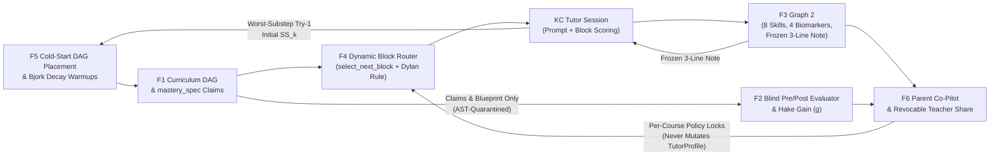

# AI Tutor Closed-Loop Architecture (F0–F6) Handover · 28 November 2026

> **Status:** Complete & live in production on Render  
> **Repository:** [`mv97hub/aitutor-mvp`](https://github.com/mv97hub/aitutor-mvp)  
> **Live Production API Revision:** [`f9377da59eeb3cf7ee21ef85d77ca7f2fcc6e00a`](https://github.com/mv97hub/aitutor-mvp/commit/f9377da59eeb3cf7ee21ef85d77ca7f2fcc6e00a) (`main`, PR #243)  
> **Live PostgreSQL Head:** `051_kc_sessions_affect_enum` ([check live `/health/revision`](https://aitutor-mvp.onrender.com/health/revision))  
> **Live Web App:** [`https://aitutor-mvp-web.onrender.com`](https://aitutor-mvp-web.onrender.com) · [Test Harness UI](https://aitutor-mvp-web.onrender.com/kc-test-children)

---

## 1. Executive Summary

All seven pillars of the closed-loop AI Tutor architecture (**F0–F6**), along with tutor prompt/scoring hardening, live Render course backfills, and two production fixes uncovered during live verification, are merged on `main` and running live on Render.

What shipped in this cycle (**PRs [#231](https://github.com/mv97hub/aitutor-mvp/pull/231) through [#243](https://github.com/mv97hub/aitutor-mvp/pull/243)**, migrations **`047`** through **`051`**):

1. **F3 — Graph 2 Eight Skills, Biomarkers & Shared Radar** ([#231](https://github.com/mv97hub/aitutor-mvp/pull/231)): Tracks 8 domain-general epistemic skills and 4 behavioral biomarkers per learner, injects a frozen 3-line tutor coaching note into lesson sessions, and renders a shared `<SkillRadar />` across Learner and Parent views.
2. **F2 — AST-Quarantined Blind Pre/Post Evaluator & Multi-Component Epistemic Rollup** ([#234](https://github.com/mv97hub/aitutor-mvp/pull/234), [#239](https://github.com/mv97hub/aitutor-mvp/pull/239)): Measures genuine transfer via a 40/30/30 cached blind Pre/Post exam, exact Hake normalized gain ($g$), quiet `/exam` UI, and single-chat plus full-course epistemic sandboxes for synthetic harness runs.
3. **F6 — Active Parent Co-Pilot & Revocable Teacher Share** ([#238](https://github.com/mv97hub/aitutor-mvp/pull/238)): Produces plain-language parent session digests, scoped per-course `course_mode` + `parent_policy_locks` (never mutating shared `TutorProfile`), and revocable SHA-256 public Teacher Share snapshots (`/teacher/share/[token]`) with zero raw chat transcript exposure.
4. **F4 — Deterministic Dynamic Block Policy Router** ([#240](https://github.com/mv97hub/aitutor-mvp/pull/240), [#242](https://github.com/mv97hub/aitutor-mvp/pull/242), [#243](https://github.com/mv97hub/aitutor-mvp/pull/243)): Routes lesson blocks deterministically via `select_next_block()` with forecast/resolve parity, Dylan Rule fast-tracking for confident Try-1 sweeps, frozen modality-affinity pivots, `actionable_spec`-gated `broken_kc` redirects, and expanded `bored` / `curious_stretch` affects.
5. **F5 — Cold-Start DAG Placement & Bjork Memory Decay Warmups** ([#241](https://github.com/mv97hub/aitutor-mvp/pull/241), [#243](https://github.com/mv97hub/aitutor-mvp/pull/243)): Places new learners onto their Zone of Proximal Development (ZPD) frontier in $\le \min(4, \lceil\log_2 N\rceil)$ jargon-free scenario probes with a zero-shame escape hatch, propagates surmise credit across prerequisites, and schedules 2-minute Bjork decay warmups when retrieval strength drops below `0.65`.
6. **Live Render Verification & Full 10/10 Course Backfill**: Non-destructively backfilled **all 10 live learner courses** on Render (**181/181 components**, **967/967 blocks**, **362 claims**, `ready: true` with `0` unintended diffs), verified `10/10` multi-component completion (`96.2%` avg blind exam score, `AI_Child1` at `100.0%`), and proved F4 fast-tracking (`-17%` to `-27%` turns, `-22%` to `-33%` cost) and F5 `SS_k = 1.00` live on Render. Every newly created course via the F1 creator pipeline receives `mastery_spec` claims and `claim_ids` automatically—no retrofitting required.

### Architecture Documentation Index

| Document | Scope |
| --- | --- |
| [F2 Architecture](f2-architecture.md) | Blind Pre/Post Evaluator, AST quarantine, Hake gain, quiet `/exam`, epistemic sandbox |
| [F3 Architecture](f3-architecture.md) | Graph 2 eight skills, 4 biomarkers, frozen 3-line tutor note, shared radar |
| [F4 Architecture](f4-architecture.md) | Deterministic Dynamic Block Policy Router (`select_next_block`), Dylan Rule, modality pivot |
| [F5 Architecture](f5-architecture.md) | Cold-Start DAG Placement, surmise propagation, Bjork storage/retrieval decay warmups |
| [F6 Architecture](f6-architecture.md) | Active Parent Co-Pilot digests, scoped course policy locks, revocable Teacher Share |
| [F4–F6 Overview](f4-f6-architecture.md) | Combined design overview linking F2/F3 baseline to F4–F6 |
| [Prior Handover (26 Nov 2026)](2026-11-26-ai-tutor-test-handover.md) | Previous baseline (56-chat harness audit, PRs #203–#222, three live course corrections) |

---

## 2. Closed-Loop System Flow



### Standing Architectural Guardrails

These invariants are enforced by automated tests and schema constraints and **must be preserved** in future work:

- **F2 Item Quarantine (AST-tested):** [`blind_evaluator.py`](../apps/api/app/blind_evaluator.py) is verified by [`test_blind_evaluator_quarantine.py`](../apps/api/tests/test_blind_evaluator_quarantine.py) to never import tutor prompt/session modules, and tutor prompts never read blind exam tables.
- **No Shared-Profile Mutation by F6 Locks:** Parent overrides (`course_mode`, `parent_policy_locks`) live exclusively on `learner_course_state` per `(student_id, goal_id)` and never mutate the shared global `TutorProfile`.
- **Zero Raw Transcript Leakage in Teacher Share:** Public [`/teacher/share/[token]`](../apps/web/app/teacher/share/%5Btoken%5D/page.tsx) snapshots expose only aggregated mastery, F3 radar scores, F2 Hake gains, and structured digest highlights—never raw chat logs. Tokens are stored as SHA-256 digests (`token_hash`).
- **Synthetic Harness Isolation:** Synthetic test-child runs (`student_id: null`) never write to real learner tables (`learner_course_state`, Graph 2 skill state, `parent_session_digests`, or real `blind_exam_attempts`).
- **Alembic Revision ID Length Ceiling:** PostgreSQL `alembic_version.version_num` is `VARCHAR(32)`. All future migration revision IDs **must stay $\le 32$ characters**.
- **Single ICAP / Mastery Authority:** F4 fast-tracking (`"fast_tracked"`, `attempts = 0`) introduces no second ICAP scale and is explicitly excluded from F3 fragile/struggle signals in [`graph2/signals.py`](../apps/api/app/graph2/signals.py).

---

## 3. Complete PR & Database Migration Ledger

### Merged Pull Requests (`main` @ `f9377da`)

| PR | Merge Commit | Area | Summary & Key Verification |
| --- | --- | --- | --- |
| [#231](https://github.com/mv97hub/aitutor-mvp/pull/231) | `a77a15a` | **F3** | Graph 2 eight skills, 4 biomarkers, frozen 3-line tutor note, shared `<SkillRadar />`, migration `047`. |
| [#232](https://github.com/mv97hub/aitutor-mvp/pull/232) | `4e223b5` | Web UI | Render each step chip once, strictly after the reply that finished the step. |
| [#233](https://github.com/mv97hub/aitutor-mvp/pull/233) | `80e4980` | Tutor / Harness | Fixed passage handoff, curiosity off-course stalls, and harness check false positives. |
| [#235](https://github.com/mv97hub/aitutor-mvp/pull/235) | `685c9fd` | Block Scoring | Marked back-to-back first-try MCQ passes as `known` instead of `fragile` ([`block_score.py`](../apps/api/app/block_score.py)). |
| [#234](https://github.com/mv97hub/aitutor-mvp/pull/234) | `9c182ae` | **F2** | AST-quarantined Blind Pre/Post Evaluator, Hake gain $g$, quiet `/exam` UI, single-chat `epistemic_sandbox`, migration `048`. |
| [#236](https://github.com/mv97hub/aitutor-mvp/pull/236) | `792f77a` | Prompting | Enforced `bite_sized` 2-sentence / 260-char cap and Try-1 MCQ non-reveal guard ([`kc_prompt.py`](../apps/api/app/kc_prompt.py)). |
| [#237](https://github.com/mv97hub/aitutor-mvp/pull/237) | `f7a5ddd` | Docs | Added combined [F4–F6 architecture overview](f4-f6-architecture.md) with live F2/F3 baseline. |
| [#238](https://github.com/mv97hub/aitutor-mvp/pull/238) | `575949a` | **F6** | Active Parent Co-Pilot digests, scoped `course_mode` + `parent_policy_locks`, revocable SHA-256 Teacher Share, migration `049`. |
| [#239](https://github.com/mv97hub/aitutor-mvp/pull/239) | `cdbf376` | **F2 Rollup** | Course-level multi-component epistemic sandbox rollup across an entire `HarnessRun` (API + Next.js proxy). |
| [#240](https://github.com/mv97hub/aitutor-mvp/pull/240) | `0680ef2` | **F4** | Deterministic Dynamic Block Policy Router (`select_next_block`), Dylan Rule fast-tracking, modality pivot, `actionable_spec`-gated `broken_kc` redirect, expanded `AFFECTS`. |
| [#241](https://github.com/mv97hub/aitutor-mvp/pull/241) | `52681fa` | **F5** | Cold-start DAG placement, surmise propagation, Bjork decay warmups, `/learn` modal & warmup card, migration `050`. Verified: **724/724** pytest, **248/248** web tests, `tsc --noEmit`, Next.js 16.4.5 build. |
| [#242](https://github.com/mv97hub/aitutor-mvp/pull/242) | `b805e10` | **F4 Hotfix** | Migration `051_kc_sessions_affect_enum` widening PostgreSQL `ck_kc_sessions_affect` for `'bored'` and `'curious_stretch'` + synced `KcSession.__table_args__` + Postgres persistence test. |
| [#243](https://github.com/mv97hub/aitutor-mvp/pull/243) | `f9377da` | **F4 & F5 Fix** | Per-substep Try-1 evaluation on multi-substep blocks for F4 Dylan Rule (`kc_loop.py`) and F5 initial stability (`kc_placement.py`). Verified: **70/70** focused pytest + live Render proof (`d04cd23d`). |

### Database Migrations (`047` – `051`)

All migrations are additive and verified on PostgreSQL (including upgrade/downgrade round-trips `049 -> 050 -> 049 -> 050` and `050 -> 051 -> 050 -> 051`).

| Revision ID | File | Schema Changes |
| --- | --- | --- |
| `047_graph2_skills_and_state` | [`047_graph2_skills_and_state.py`](../apps/api/alembic/versions/047_graph2_skills_and_state.py) | Adds Graph 2 skill/biomarker state tables and frozen tutor-note storage for F3. |
| `048_blind_evaluator_tables` | [`048_blind_evaluator_tables.py`](../apps/api/alembic/versions/048_blind_evaluator_tables.py) | Adds cached 40/30/30 blind Pre/Post exam forms, attempts, and Hake gain storage for F2. |
| `049_parent_copilot_share` | [`049_parent_copilot_share.py`](../apps/api/alembic/versions/049_parent_copilot_share.py) | Adds `parent_session_digests`, `teacher_share_tokens` (SHA-256 `token_hash`), `learner_course_state.course_mode` & `parent_policy_locks`, and `kc_goals` catalog metadata. |
| `050_f5_placement_state` | [`050_f5_placement_state.py`](../apps/api/alembic/versions/050_f5_placement_state.py) | Adds `placement_status` (`not_started` / `in_progress` / `completed` / `skipped`) and JSONB `placement_state` to `learner_course_state`. |
| `051_kc_sessions_affect_enum` | [`051_kc_sessions_affect_enum.py`](../apps/api/alembic/versions/051_kc_sessions_affect_enum.py) | Widens legacy `ck_kc_sessions_affect` check constraint (originally created in `021_kc_seven_layer.py`) to accept `'bored'` and `'curious_stretch'`. |

---

## 4. Feature-by-Feature Technical Reference

### F2 — Blind Pre/Post Evaluator & Multi-Component Epistemic Sandbox
- **Backend:** [`apps/api/app/blind_evaluator.py`](../apps/api/app/blind_evaluator.py), [`apps/api/app/routes/blind_exam.py`](../apps/api/app/routes/blind_exam.py), [`apps/api/app/routes/harness.py`](../apps/api/app/routes/harness.py)
- **Frontend:** [`apps/web/app/learn/[studentId]/course/[courseId]/exam/page.tsx`](../apps/web/app/learn/%5BstudentId%5D/course/%5BcourseId%5D/exam/page.tsx), [`apps/web/components/learn/BlindExamClient.tsx`](../apps/web/components/learn/BlindExamClient.tsx), [`apps/web/lib/blind-exam.ts`](../apps/web/lib/blind-exam.ts)
- **Next.js API Proxies:** [`/api/kc/exam/prepare`](../apps/web/app/api/kc/exam/prepare/route.ts), [`/api/kc/exam/submit`](../apps/web/app/api/kc/exam/submit/route.ts), [`/api/kc/exam/epistemic`](../apps/web/app/api/kc/exam/epistemic/route.ts)
- **FastAPI Endpoints:**
  - `GET /kc/tutor/courses/{course_id}/exam` · `POST /kc/tutor/courses/{course_id}/exam/prompt` · `POST /kc/tutor/courses/{course_id}/exam`
  - `POST /kc/tutor/courses/{course_id}/exam/grade-prompt` · `POST /kc/tutor/courses/{course_id}/exam/attempts`
  - `GET /kc/harness/chats/{chat_id}/epistemic-context` · `POST /kc/harness/chats/{chat_id}/blind-post-test`
  - `GET /kc/harness/runs/{run_id}/epistemic-context` · `POST /kc/harness/runs/{run_id}/blind-post-test` (multi-component rollup supporting `{ runId, courseId, personaId }` in the Next.js proxy)
- **Key Mechanics:** Cached 40% recall / 30% application / 30% transfer forms; exact Hake normalized gain $g = (\text{post} - \text{pre}) / (1 - \text{pre})$ (with ceiling guard); strict AST quarantine verified by [`test_blind_evaluator_quarantine.py`](../apps/api/tests/test_blind_evaluator_quarantine.py) and [`test_blind_evaluator.py`](../apps/api/tests/test_blind_evaluator.py).

### F3 — Graph 2 Eight Skills, Biomarkers & Shared Radar
- **Backend:** [`apps/api/app/graph2/signals.py`](../apps/api/app/graph2/signals.py), [`apps/api/app/graph2/judge.py`](../apps/api/app/graph2/judge.py), [`apps/api/app/graph2/state.py`](../apps/api/app/graph2/state.py), [`apps/api/app/graph2/digest.py`](../apps/api/app/graph2/digest.py), [`apps/api/app/routes/graph2.py`](../apps/api/app/routes/graph2.py)
- **Frontend:** [`apps/web/components/progress/SkillRadar.tsx`](../apps/web/components/progress/SkillRadar.tsx), [`apps/web/components/learn/SkillEndCard.tsx`](../apps/web/components/learn/SkillEndCard.tsx), [`apps/web/lib/graph2.ts`](../apps/web/lib/graph2.ts)
- **FastAPI Endpoints:**
  - `GET /kc/students/{student_id}/radar`
  - `POST /kc/tutor/sessions/{session_id}/graph2/judge-prompt` · `POST /kc/tutor/sessions/{session_id}/graph2/judge-result` · `POST /kc/tutor/sessions/{session_id}/graph2/judge-failed`
- **Key Mechanics:** Tracks 8 skills (`evidence`, `perspectives`, `causes`, `inquiry`, `errors`, `transfer`, `explaining`, `calibration`) and 4 biomarkers; builds a frozen 3-line tutor note injected into the lesson prompt; tested in [`test_graph2_f3.py`](../apps/api/tests/test_graph2_f3.py) and [`graph2.test.ts`](../apps/web/lib/graph2.test.ts).

### F4 — Deterministic Dynamic Block Policy Router
- **Backend:** [`apps/api/app/kc_loop.py`](../apps/api/app/kc_loop.py) (`select_next_block`, `_clean_pass_attempt_ceiling`, `_block_passed_cleanly_first_try`), [`apps/api/app/kc_moves.py`](../apps/api/app/kc_moves.py) (`AFFECTS`), [`apps/api/app/models.py`](../apps/api/app/models.py) (`KcSession` check constraint)
- **Key Mechanics:**
  - **Forecast/Resolve Parity:** UI preview and runtime block resolution share the single deterministic `select_next_block()` state machine.
  - **Dylan Rule Fast-Tracking:** When a learner sweeps the opening block cleanly on Try-1 (evaluated per substep via `_clean_pass_attempt_ceiling` after PR #243), redundant drill blocks are fast-tracked (`outcome = "fast_tracked"`, `attempts = 0`), preserving full mastery while skipping unnecessary turns. Fast-tracked blocks are excluded from F3 struggle signals.
  - **Modality Affinity Pivot:** Uses a frozen per-session modality affinity snapshot to pivot away from repeated friction without oscillating mid-block.
  - **Guarded `broken_kc` Redirect:** Only redirects on `actionable_spec(mastery_spec)` so legacy courses without `mastery_spec` keep clean fallback routing.
  - **Expanded Affects:** Persists `'bored'` and `'curious_stretch'` alongside baseline affects in PostgreSQL.
- **Tests:** [`test_f4_dynamic_router.py`](../apps/api/tests/test_f4_dynamic_router.py).

### F5 — Cold-Start DAG Placement & Bjork Memory Decay Warmups
- **Backend:** [`apps/api/app/kc_placement.py`](../apps/api/app/kc_placement.py), [`apps/api/app/routes/kc.py`](../apps/api/app/routes/kc.py)
- **Frontend:** [`apps/web/components/learn/CoursePlacementModal.tsx`](../apps/web/components/learn/CoursePlacementModal.tsx), [`apps/web/components/learn/MemoryWarmupCard.tsx`](../apps/web/components/learn/MemoryWarmupCard.tsx), [`apps/web/components/learn/ChildHome.tsx`](../apps/web/components/learn/ChildHome.tsx), [`apps/web/components/learn/LearnQuestPanel.tsx`](../apps/web/components/learn/LearnQuestPanel.tsx), [`apps/web/lib/f5-placement.ts`](../apps/web/lib/f5-placement.ts)
- **FastAPI Endpoints:**
  - `GET /kc/tutor/courses/{course_id}/placement`
  - `POST /kc/tutor/courses/{course_id}/placement/start`
  - `POST /kc/tutor/courses/{course_id}/placement/answer`
  - `POST /kc/tutor/courses/{course_id}/placement/skip`
  - `POST /kc/tutor/courses/{course_id}/warmups/{kc_id}/submit`
- **Key Mechanics:**
  - **Cold-Start DAG Placement:** Uses Kahn topological sort over course prerequisites; binary-searches the DAG in at most $\min(4, \lceil\log_2 N\rceil)$ jargon-free scenario probes (eligible on multi-component courses with $N \ge 2$). Includes a zero-shame `"Not sure yet — teach me this!"` button. Passed nodes propagate surmise credit to ancestors (`status='known'`, `stability=0.75`, `result.source='placement_surmise'`) and drop the learner directly onto their ZPD frontier.
  - **Bjork Storage / Retrieval Decay:** Assigns hint-weighted initial storage strength $SS_k$ (`1.00` clean Try-1, `0.70` single retry/hint, `0.45` heavy scaffolding, evaluated using worst per-requirement attempts after PR #243). Computes retrieval strength:
    $$RS_k(t) = \exp\!\left(-\frac{\Delta t_{\text{days}}}{7.0 \cdot SS_k}\right)$$
    When $RS_k < 0.65$, surfaces a 2-minute Memory Warmup card on `/learn`. Passing a warmup boosts storage strength ($SS_k \leftarrow 1.8 \cdot SS_k + 0.5$) and resets decay.
- **Tests:** [`test_f5_placement_and_decay.py`](../apps/api/tests/test_f5_placement_and_decay.py), [`f5-placement.test.ts`](../apps/web/lib/f5-placement.test.ts).

### F6 — Active Parent Co-Pilot & Revocable Teacher Share
- **Backend:** [`apps/api/app/parent_copilot.py`](../apps/api/app/parent_copilot.py), [`apps/api/app/routes/parents.py`](../apps/api/app/routes/parents.py), [`apps/api/app/routes/teacher_share.py`](../apps/api/app/routes/teacher_share.py)
- **Frontend:** [`apps/web/components/parent/ParentCopilotPanel.tsx`](../apps/web/components/parent/ParentCopilotPanel.tsx), [`apps/web/components/parent/ParentDashboard.tsx`](../apps/web/components/parent/ParentDashboard.tsx), [`apps/web/app/teacher/share/[token]/page.tsx`](../apps/web/app/teacher/share/%5Btoken%5D/page.tsx), [`apps/web/lib/parent-copilot.ts`](../apps/web/lib/parent-copilot.ts)
- **FastAPI Endpoints:**
  - `GET /parents/{parent_id}/children/{student_id}/copilot`
  - `POST /parents/{parent_id}/children/{student_id}/interventions/apply`
  - `GET /parents/{parent_id}/children/{student_id}/teacher-shares`
  - `POST /parents/{parent_id}/children/{student_id}/teacher-shares`
  - `DELETE /parents/{parent_id}/children/{student_id}/teacher-shares/{share_id}`
  - `GET /teacher/share/{token}` (public read-only token view; returns unavailable immediately upon revocation or expiry)
- **Tests:** [`test_parent_copilot_f6.py`](../apps/api/tests/test_parent_copilot_f6.py), [`parent-copilot.test.ts`](../apps/web/lib/parent-copilot.test.ts).

### Tutor Quality, Prompt & Scoring Polish
- **Back-to-Back First-Try MCQ Scoring (PR #235):** [`apps/api/app/block_score.py`](../apps/api/app/block_score.py) + [`test_mcq_back_to_back_score.py`](../apps/api/tests/test_mcq_back_to_back_score.py).
- **`bite_sized` Length Cap & Try-1 MCQ Non-Reveal Guard (PR #236):** [`apps/api/app/kc_prompt.py`](../apps/api/app/kc_prompt.py) enforces a 2-sentence / 260-character ceiling for `bite_sized` personas and prevents leaking the MCQ answer after a single wrong try ([`test_bite_sized_and_mcq_nudge.py`](../apps/api/tests/test_bite_sized_and_mcq_nudge.py)).
- **Passage Handoff & Off-Course Curiosity Fixes (PR #233):** [`test_harness_audit_fixes.py`](../apps/api/tests/test_harness_audit_fixes.py).

---

## 5. Live Render Production Course Backfill (10 / 10 Learner Courses Complete)

All **10 live learner courses** on Render have been non-destructively backfilled with structured `mastery_spec` claims and per-block `claim_ids`, republished (`ready: true`, `missing: []`), and round-trip verified against their pre-backfill exports (**0 unintended diffs** to titles, descriptions, core truths, rubrics, misconceptions, standards, unit groupings, component order, or block data; verbatim pre-backfill JSON backups archived prior to mutation):

| Live Render Course | Course UUID | Components Ready | Blocks Tagged (`claim_ids`) | Claims | F5 Placement | Active F3 Skills (`actionable=True`) |
| --- | --- | --- | --- | --- | --- | --- |
| **How does AI Work** *(best all-in-one test)* | `7ac9be86-0127-4acf-899d-e934dfb00808` | `5 / 5` | `27 / 27` | `10` | Eligible (`max_probes: 3`) | `causes`, `errors`, `evidence`, `inquiry`, `perspectives`, `transfer` (**6**) |
| **Treaty of Versailles** | `0d8e0717-25c6-430e-b0bf-68ec376ea30a` | `1 / 1` | `7 / 7` | `2` | Single-comp (`N < 2`) | `causes`, `evidence` (**2**) |
| **Grade 6 - Social Sciences** | `c233746c-2371-45a0-b288-b338de69b24f` | `6 / 6` | `31 / 31` | `12` | Eligible | `causes`, `errors`, `evidence`, `explaining`, `inquiry`, `perspectives`, `transfer` (**7**) |
| **Test_Explanatory** | `b9d80a7d-7329-4a21-90d7-c45003e26135` | `9 / 9` | `22 / 22` | `18` | Eligible | `causes`, `errors`, `evidence`, `explaining`, `inquiry`, `perspectives`, `transfer` (**7**) |
| **AP Geography** | `ed41dfa2-9747-4198-927d-dd089441bf03` | `12 / 12` | `51 / 51` | `24` | Eligible | `evidence` (**1**) |
| **Roman History** | `0826e87d-949a-4f8b-9a9b-a58ef2ef3f8a` | `12 / 12` | `67 / 67` | `24` | Eligible | `evidence` (**1**) |
| **Romeo and Juliet** | `6a43ff87-66d6-455f-baec-709dfa64b350` | `12 / 12` | `52 / 52` | `24` | Eligible | `evidence` (**1**) |
| **AP Psychology** | `8acfa84b-e66a-447f-a693-ec3c82a2f4ca` | `35 / 35` | `210 / 210` | `70` | Eligible | `causes`, `errors`, `evidence`, `explaining`, `perspectives`, `transfer` (**6**) |
| **AP Macroeconomics** | `d88dd955-166e-4136-b685-5f78bfc0d975` | `42 / 42` | `213 / 213` | `84` | Eligible | `causes`, `errors`, `evidence`, `explaining`, `inquiry`, `perspectives`, `transfer` (**7**) |
| **GCSE History** | `0181821c-2fb8-40eb-8f7d-298c66645554` | `47 / 47` | `287 / 287` | `94` | Eligible | `causes`, `errors`, `evidence`, `explaining`, `inquiry`, `perspectives`, `transfer` (**7**) |
| **Total (All Live Learner Courses)** | **10 / 10 `ready: true`** | **`181 / 181`** | **`967 / 967`** | **`362`** | **9 / 10 multi-comp** | **Full F2–F6 active across every live learner course** |

> **New Courses & Harness Fixtures:**
> - **All newly created courses** created via the F1 KC Creator pipeline ([`kc_pipeline.py`](../apps/api/app/kc_pipeline.py)) receive `mastery_spec` claims and block `claim_ids` automatically—**no manual retrofitting is ever needed for new courses**.
> - **Synthetic Harness Fixtures** (*Harness fixture: every block type* and *Harness fixture · learner scenarios*) remain intentionally unmodified to preserve deterministic test-harness baselines.

---

## 6. Live Render Production Benchmark Scorecard

All four benchmarks below ran against live Render production (`aitutor-mvp.onrender.com`) with real LLM tutor calls and PostgreSQL persistence (`student_id: null` isolation preserved throughout).

| Run ID | Commit | Course & Scope | Concurrency | Completion | Turns & Cost | Auto Quality Checks | Key Outcome |
| --- | --- | --- | --- | --- | --- | --- | --- |
| **Run A** `a300ce62-14e3-42d0-a465-04c65cbe2c7e` | `b805e10` | *Treaty of Versailles* (1 comp × 4 personas: `AI_Child1`, `AI_Child2` bite_sized, `AI_Child3`, `AI_Child13`) | `2` | **4 / 4 (100%)** | `93` turns · `$0.0304` | `0` err, `0` giv, `0` leaks, `0` false_fails, `0` stuck; `18/18` 1q; `7/7` stay; `32/33` ask0; `1` too_long (`AI_Child2`) | `45` `curious_stretch` affects saved cleanly; F2 Blind Exam avg **86.5%** (`AI_Child13` **92.3%**, `100%` transfer). |
| **Run B** `4ca57f5c-c0e3-40b0-9342-e46ebfd9edb1` | `b805e10` | *How does AI Work* (5 comps × 2 personas: `AI_Child1`, `AI_Child3`) | `2` | **10 / 10 (100%)** | `211` turns · `$0.0555` | `0` err, `0` giv, `0` stuck; `19/19` 1q; `23/23` stay; `64/70` ask0; `1` leak (`0.5%`), `1` false_fail (`0.5%`), `3` too_long | `154` `curious_stretch` affects saved; F2 5/5 Course Rollup avg **96.2%** (**`AI_Child1` 100.0%**, **`AI_Child3` 92.3%**). |
| **Diag Run** `6e658eeb-9fac-4efe-a869-2dbd0c308636` | `b805e10` | *How does AI Work* (`c2`, `c4` × `AI_Child3`, `AI_Child13`) | `2` | **4 / 4 (`known`)** | `68` turns · `$0.0187` | `0` err, `0` giv, `0` leaks, `0` false_fails, `0` stuck | Confirmed backfill claims worked cleanly; exposed multi-substep counter bug fixed in PR #243. |
| **F4+F5 Proof** `d04cd23d-b1c6-4fa3-9934-e379663708f6` | `f9377da` | *How does AI Work* (`c2`, `c4` × `AI_Child13`) | `2` | **2 / 2 (`known`)** | `21` turns · `$0.0057` | `0` err, `0` giv, `0` leaks, `0` too_long; `9/9` ask0; `2/2` 1q | Live proof of F4 Dylan Rule fast-tracking (`mcq1` / `mcq-1` `outcome="fast_tracked"`, `attempts=0`) + F5 `SS_k = 1.00`. |

### F2 Blind Exam Epistemic Rollup Progression (*How does AI Work*)

| Stage | Components Covered | `AI_Child1` Blind Score | `AI_Child3` Blind Score | Notes |
| --- | --- | --- | --- | --- |
| Pre-Rollup Single Chat | `1 / 5` | `61.5%` | — | Single-session context missed 4 of 5 course components. |
| Partial Rollup (`d5d2cf35`, `concurrency: 4`) | `4 / 5` | `92.3%` | — | 2 chats stalled under `concurrency: 4`. |
| **Full Canonical Rollup (`4ca57f5c`, `concurrency: 2`)** | **`5 / 5 (100%)`** | **`100.0%`** (`100%` MCQ / `100%` transfer, 141 msgs) | **`92.3%`** (`100%` MCQ / `83.3%` transfer, 124 msgs, `5/5 known`) | **96.2% combined course average** with `student_id: null` isolation. |

### Live F4 Dylan Rule & F5 Stability Proof (Before vs. After PR #243 on `AI_Child13`)

| Component | Before PR #243 (`6e658eeb`) | After PR #243 (`d04cd23d`) | Live Delta |
| --- | --- | --- | --- |
| **`c2` (*What is AI?*)** | `15` turns · `$0.0046` · `mcq1` drilled | **`11` turns · `$0.0031`** · `mcq1` → `fast_tracked` (`attempts=0`) · **`SS_k = 1.00`** (`RS = 0.9999`) | **-27% turns · -33% cost** |
| **`c4` (*Generative AI*)** | `12` turns · `$0.0035` · `mcq-1` drilled | **`10` turns · `$0.0027`** · `mcq-1` → `fast_tracked` (`attempts=0`) · **`SS_k = 1.00`** (`RS = 0.9999`) | **-17% turns · -22% cost** |

### F5 Read-Only Live Production Smoke Check
- `GET /kc/tutor/courses/7ac9be86-0127-4acf-899d-e934dfb00808/placement` (*How does AI Work*, 5 components) → `eligible: true`, `component_count: 5`, `max_probes: 3`.
- `GET /kc/tutor/courses/0d8e0717-25c6-430e-b0bf-68ec376ea30a/placement` (*Treaty of Versailles*, 1 component) → `eligible: false`.
- Next.js SSR `/learn/<studentId>` → HTTP `200`.

---

## 7. Production Issues Caught & Resolved During Verification

1. **Schema Drift on `ck_kc_sessions_affect` (HTTP 409 on Live Render → Fixed in [PR #242](https://github.com/mv97hub/aitutor-mvp/pull/242))**
   - **Symptom:** Turn 1 of live Render diagnostic runs `f0bf5a61` and `2c561a60` failed with HTTP `409` (`IntegrityError`).
   - **Root Cause:** Legacy migration `021_kc_seven_layer.py` defined a PostgreSQL `CHECK` constraint (`ck_kc_sessions_affect`) that was never mirrored in SQLAlchemy `models.py`. SQLite/model unit tests did not enforce it, so PostgreSQL rejected F4's new `'bored'` and `'curious_stretch'` affects.
   - **Fix:** Added migration [`051_kc_sessions_affect_enum.py`](../apps/api/alembic/versions/051_kc_sessions_affect_enum.py), mirrored the constraint in `KcSession.__table_args__` ([`models.py`](../apps/api/app/models.py)), added a PostgreSQL persistence test, and cleanly cancelled runs `f0bf5a61` and `2c561a60`. Subsequently **199** `curious_stretch` affects (`45` in Run A + `154` in Run B) persisted without error.

2. **Multi-Substep Attempt Counter Granularity (Fixed in [PR #243](https://github.com/mv97hub/aitutor-mvp/pull/243))**
   - **Symptom:** On `6e658eeb`, `AI_Child13` swept multi-substep blocks cleanly (`worked_example` = 2 substeps, `socratic` = 3 substeps) yet did not trigger Dylan Rule fast-tracking and received discounted F5 initial stability.
   - **Root Cause:** `block_results.attempts` sums learner turns across all substeps in a block (`2` or `3`), whereas the Try-1 check compared total `attempts <= 1`.
   - **Fix:** Added `_clean_pass_attempt_ceiling()` and `_block_passed_cleanly_first_try()` in [`kc_loop.py`](../apps/api/app/kc_loop.py) (with a safe `cfg is None` fallback for legacy unit tests) and updated `initial_stability_for_session()` in [`kc_placement.py`](../apps/api/app/kc_placement.py) to evaluate worst per-requirement attempts. Verified live in `d04cd23d`.

3. **Render Single-Container Harness Concurrency Limit (Operational Guideline)**
   - **Observation:** Multi-component Render runs at `concurrency: 4` (`d5d2cf35`) stalled `2 / 10` chats due to worker contention on Render's single Web container.
   - **Guideline:** Always launch multi-component Render harness runs at **`concurrency: 2`**, which achieved **10 / 10 (`100%`)** clean completion in `4ca57f5c` and **4 / 4 (`100%`)** in `a300ce62`.

---

## 8. Remaining Human Verification & Housekeeping

All backend migrations, API contracts, automated tests (**724** Python tests + **248** web tests + TypeScript + Next.js 16.4.5 production build), and live synthetic Render benchmarks are green. Because synthetic harness students intentionally do not write to real-learner tables, **one 5-minute manual browser walkthrough with a real child/parent profile** remains to close out full human UX acceptance:

### 5-Minute Live Browser Walkthrough Checklist

- [ ] **F5 Cold-Start Placement (`/learn`):**
  1. Open [`https://aitutor-mvp-web.onrender.com/learn`](https://aitutor-mvp-web.onrender.com/learn) as a real learner and select **How does AI Work** (fastest 5-component walkthrough—though any of the 9 multi-component courses such as *Grade 6 - Social Sciences*, *AP Macroeconomics*, *AP Psychology*, or *GCSE History* now work identically).
  2. Confirm the 2-option Placement modal launches cleanly (`max_probes: 3`).
  3. Answer 1–2 probes and click **"Not sure yet — teach me this!"** on one probe; verify zero-shame messaging and confirm the learner lands on their ZPD frontier (with ancestor components marked known via placement surmise).
- [ ] **F2 Quiet Pre/Post Exam (`/learn/[studentId]/course/[courseId]/exam`):**
  1. Launch the course Pre-Test or Post-Test from the learner view.
  2. Confirm the quiet exam layout renders the 40/30/30 item mix without tutor chat leakage, submits cleanly, and displays exact score / Hake normalized gain ($g$).
- [ ] **F3 Radar + F6 Parent Co-Pilot & Revocable Teacher Share (`/parent/[parentId]`):**
  1. Open [`https://aitutor-mvp-web.onrender.com/parent`](https://aitutor-mvp-web.onrender.com/parent) for the parent account linked to that learner.
  2. Confirm the **F3 8-Skill Radar** and **F6 Session Digest** render accurately.
  3. Apply a 1-click **Course Policy Lock / Course Mode** override and confirm it persists for that course without altering other courses or global `TutorProfile`.
  4. Click **Generate Teacher Share Link**, open `/teacher/share/[token]` in an incognito browser window, and confirm **zero raw chat transcripts** appear anywhere on the page.
  5. Return to `/parent`, click **Revoke**, reload the incognito `/teacher/share/[token]` tab, and confirm it immediately returns **Snapshot Unavailable**.

### Optional Housekeeping

- **Tidy Superseded Open PRs:** PRs [#194](https://github.com/mv97hub/aitutor-mvp/pull/194) (`codex/closed-loop-architecture-spec`) and [#198](https://github.com/mv97hub/aitutor-mvp/pull/198) (`codex/block-closing-review-docs`) are older spec/planning doc drafts now superseded by [`f2-architecture.md`](f2-architecture.md)–[`f6-architecture.md`](f6-architecture.md) and this handover. They can be closed safely to clear the open PR queue.

---

## 9. Local Development & Verification Quick-Start

### Check Live Production State (Read-Only)
```bash
curl -sS https://aitutor-mvp.onrender.com/health/revision
# Expected:
# {"api_commit":"f9377da59eeb3cf7ee21ef85d77ca7f2fcc6e00a","database_revisions":["051_kc_sessions_affect_enum"]}
```

### Backend (FastAPI + Alembic + Pytest)
```bash
cd apps/api
alembic upgrade head
pytest -q
# Focused F2–F6 regression suite:
pytest -q \
  tests/test_blind_evaluator.py \
  tests/test_blind_evaluator_quarantine.py \
  tests/test_graph2_f3.py \
  tests/test_f4_dynamic_router.py \
  tests/test_f5_placement_and_decay.py \
  tests/test_parent_copilot_f6.py \
  tests/test_block_close.py \
  tests/test_kc.py
```

### Frontend (Next.js 16.4.5 + TypeScript + Unit Tests)
```bash
cd apps/web
npm test
npx tsc --noEmit
npm run build
```
