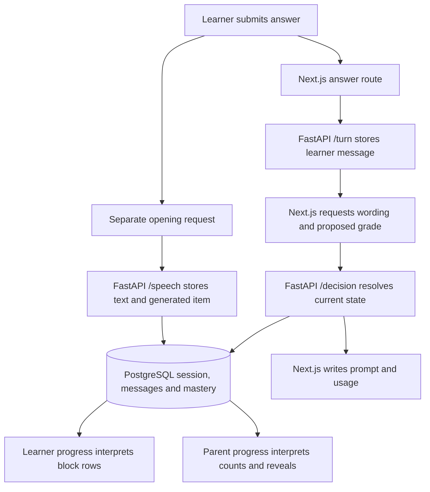
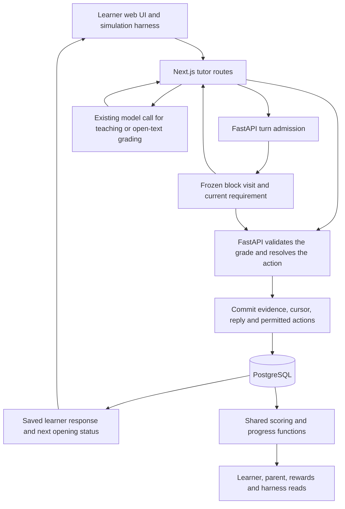
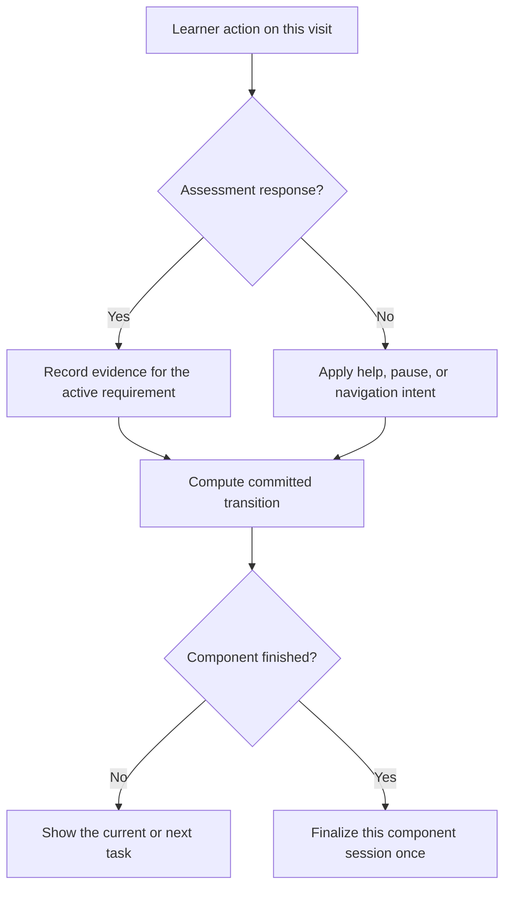
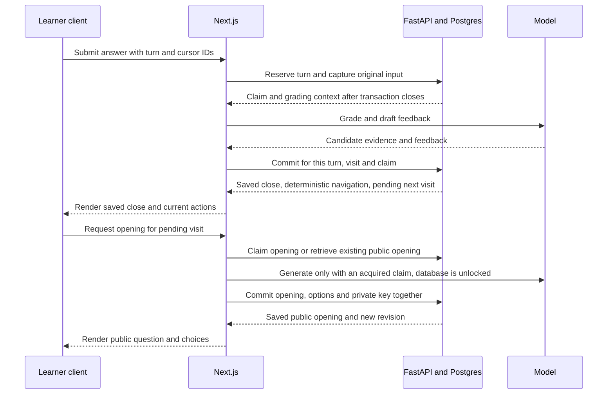
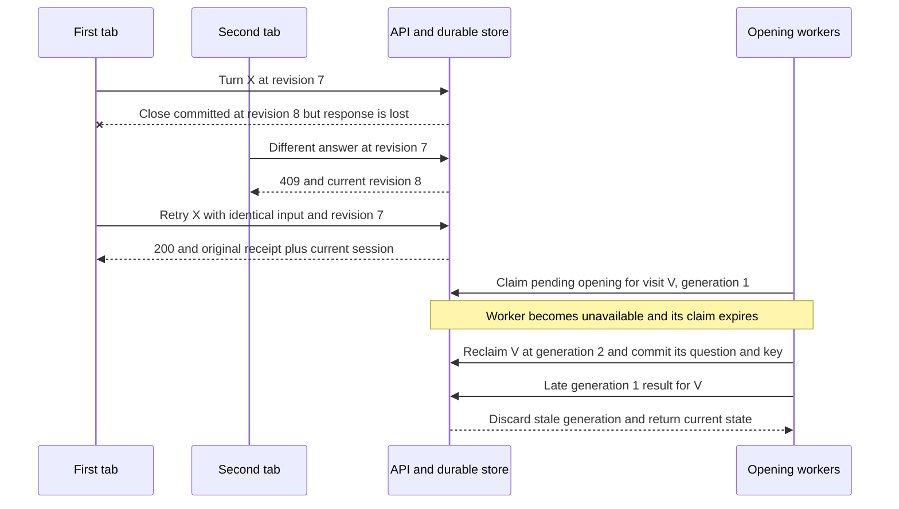
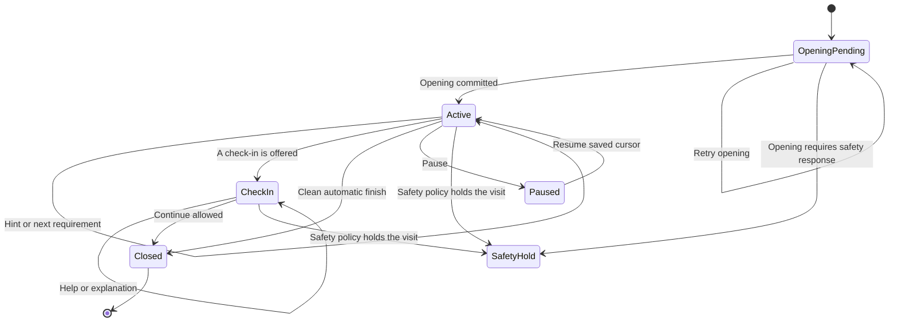
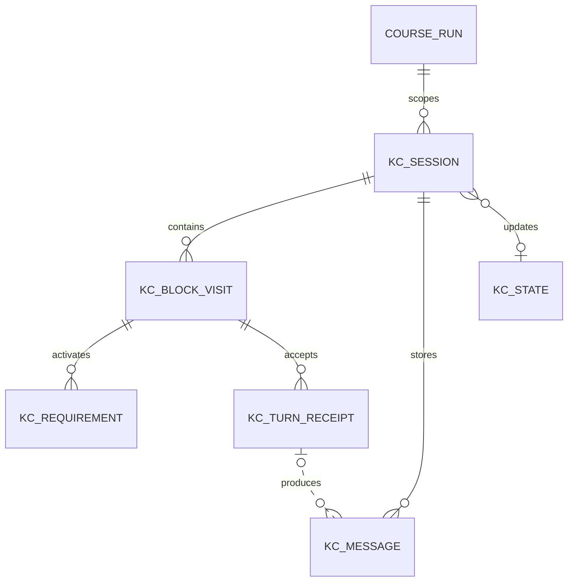
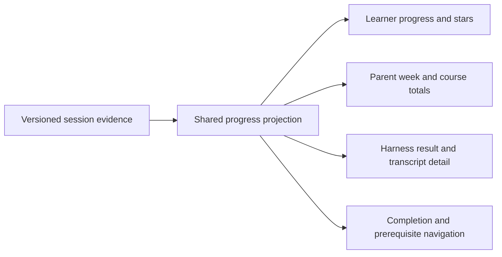
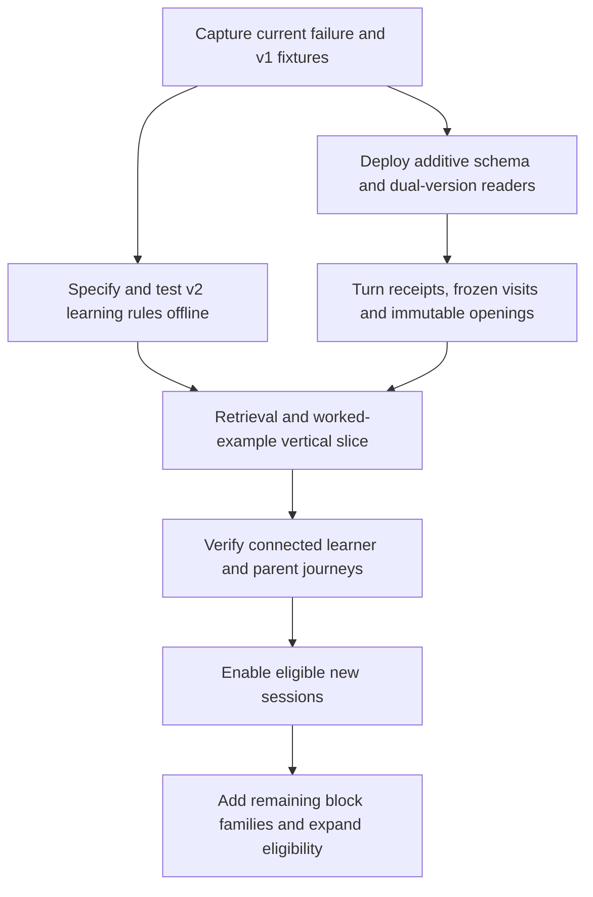

# AI Tutor · Consistent block closing

**Revised architecture and implementation plan**  
26 November 2026 · Engineering proposal · Repository `mv97hub/aitutor-mvp` · Reviewed main revision `d12e48d`

**Decision requested.** Approve a single server-side decision for each learner action. Start with the failure in retrieval, and carry its fix through the child’s screen, saved session, and parent report before applying it to the other activities. Keep the current Next.js tutor, FastAPI application, PostgreSQL database, and eleven block types. This document is a specification for work to implement. The observations in section 1 describe the reviewed code. Sections 2–10 specify proposed behavior, including the scoring defaults to ratify.

**The outcome a family should see.** The tutor shows a child what a *menu cost* is. The child independently explains why these costs grow during high inflation. The activity finishes. The parent can see “The tutor supplied the definition” alongside “Your child explained why it matters.” Refreshing the lesson or asking for help leaves both facts intact.

The diagrams are embedded as Mermaid and render in GitHub-compatible Markdown viewers. Each has a text explanation or contract table for plain-text readers.

| If you are reviewing… | Start here |
| --- | --- |
| Architecture and scope | Sections [1](#1-architecture-review) and [2](#2-revised-architecture-and-ownership) compare the current paths, the uploaded plan, and the proposed ownership boundaries. |
| Teaching and assessment | Sections [3](#3-learning-evidence) and [4](#4-block-contracts) define evidence, assistance, and the finish condition for every block. |
| APIs and learner interaction | Sections [5](#5-turn-protocol) and [6](#6-learner-experience-and-recovery) specify submission, retry, recovery, opening generation, and what the learner sees. |
| Storage and reporting | Sections [7](#7-persistence-and-invariants) and [8](#8-completion-mastery-and-reporting) define durable identity, transactions, progression, scoring versions, and rewards. |
| Delivery and sign-off | Sections [9](#9-implementation-migration-and-rollout) and [10](#10-acceptance-and-architectural-sign-off) give migration order, rollout gates, fault-injection scenarios, and release evidence. |

## 1. Architecture review

### Reproduced on the reviewed revision

In an isolated run of the existing resolver, two recall misses produced one reveal. A correct answer to the separate “why” question moved the activity to its check-in. Continue returned `outcome=passed`, `reveals=1`, and `mark_known=True`. The current retrieval regression ends when the tutor reveals the fact. It never reaches the subsequent answer or component verdict. Eight focused tests covering Phase A exits, the clean middle-block close, and the explanation-to-goal handoff pass on this revision. The reproduction is a resolver result. An end-to-end stored record and parent response are acceptance targets in section 10. [Retrieval fixture and test](https://github.com/mv97hub/aitutor-mvp/blob/d12e48da31a5cfcab5b39512cd7f32b81b6f88ba/apps/api/tests/test_phase_a_loop_exits.py#L160-L169) · [Current component verdict](https://github.com/mv97hub/aitutor-mvp/blob/d12e48da31a5cfcab5b39512cd7f32b81b6f88ba/apps/api/app/kc_loop.py#L2579-L2616)

### The current write and read paths



These writes happen at different times. A learner message can be durable before its grading decision, and a decision can be durable before the web route returns success. The opening is another request that can succeed or fail independently. These boundaries already exist on the normal learner path. [Web orchestration](https://github.com/mv97hub/aitutor-mvp/blob/d12e48da31a5cfcab5b39512cd7f32b81b6f88ba/apps/web/app/api/kc/tutor/answer/route.ts#L143-L249) · [Opening storage](https://github.com/mv97hub/aitutor-mvp/blob/d12e48da31a5cfcab5b39512cd7f32b81b6f88ba/apps/api/app/kc.py#L4523-L4547)

| Decision in the uploaded cleanup plan | Engineering assessment and revision |
| --- | --- |
| Separate evidence, navigation, and presentation | Retain all three as fields of one committed outcome. Independent writes for each could leave the screen and score on different turns. |
| Make forecast and resolver agree | Use one transition function where the inputs are known. A forecast runs before the grader returns rubric and misconception information. Treat it as a preview. Render navigation and the closing sentence from the actual decision. [Forecast inputs](https://github.com/mv97hub/aitutor-mvp/blob/d12e48da31a5cfcab5b39512cd7f32b81b6f88ba/apps/api/app/kc_loop.py#L2692-L2750) |
| Persist each substep and settle every component once | Give each assessable occurrence a stable identity and freeze its criterion. Finalization must also handle participation-only components and use the identical calculation during recovery. [Current recovery](https://github.com/mv97hub/aitutor-mvp/blob/d12e48da31a5cfcab5b39512cd7f32b81b6f88ba/apps/api/app/kc.py#L2360-L2419) |
| Add idempotency after the first scoring change | Develop the scorer on fixtures immediately. Put duplicate protection and frozen openings on the real path before enabling new scores for learners. The current decision reads the latest learner message, and duplicate speech can change the key before checking whether an opening exists. [Decision input](https://github.com/mv97hub/aitutor-mvp/blob/d12e48da31a5cfcab5b39512cd7f32b81b6f88ba/apps/api/app/kc.py#L4189-L4205) · [Speech handler](https://github.com/mv97hub/aitutor-mvp/blob/d12e48da31a5cfcab5b39512cd7f32b81b6f88ba/apps/api/app/kc.py#L4536-L4547) |
| Fix parent progress | Expand the read contract to learner progress, prerequisites, course completion, rewards, and the test harness. The same completed session currently receives several interpretations. [Prerequisites](https://github.com/mv97hub/aitutor-mvp/blob/d12e48da31a5cfcab5b39512cd7f32b81b6f88ba/apps/api/app/kc.py#L2503-L2517) · [Parent counts](https://github.com/mv97hub/aitutor-mvp/blob/d12e48da31a5cfcab5b39512cd7f32b81b6f88ba/apps/api/app/parents.py#L312-L360) |

### Relationship to the wider blueprint

PR #194 proposed per-block teaching rules, richer learner evidence, and distinct turn-time and component-close responsibilities. These fit the cleanup. Its F0–F6 implementation sequence targeted `b4c6f4c`. Main has since acquired the clean middle-block exit, legacy cleanup, and migration `044_kc_mastery_spec`. Build a forward migration from the actual Alembic head. Future claim-level assessment can consume independently attributed evidence once an author explicitly maps a requirement to a claim. A completed activity alone supplies no such mapping. The exam, skills radar, adaptive router, placement, and parent co-pilot remain separate future decisions. [Blueprint at its reviewed revision](https://github.com/mv97hub/aitutor-mvp/blob/6f8b4e5471c09d82ae43ed48e77d9db35f46aef5/docs/architecture.md) · [Current migration](https://github.com/mv97hub/aitutor-mvp/blob/d12e48da31a5cfcab5b39512cd7f32b81b6f88ba/apps/api/alembic/versions/044_kc_mastery_spec.py#L1-L25)

## 2. Revised architecture and ownership

A **component** is the unit covered by one tutor session. A **visit** is one encounter with a particular block in that session. A **requirement** is the smallest piece of learner work that can independently earn credit. A **turn** is one submitted action, including Help or Continue. An **opening** is the saved first presentation of a visit. An **observation** records what happened to one requirement on a turn. These lifetimes explain why a UI step number, a message sequence, or a block’s title is an inadequate grading key.



| Owner | Responsibility and interface |
| --- | --- |
| Next.js and the learner UI | Carry the same turn ID through retries, show saved messages and actions, and invoke the existing provider path for teaching text. Return public option IDs and text to the screen. |
| FastAPI tutor routes and `kc.py` | Admit the exact action, load the visit snapshot, handle concurrency, apply a decision once, and return the committed response. Resume reads committed state. |
| Existing `kc_loop.py` resolver | Implement the transition as a deterministic calculation over the visit, learner action, evidence to date, and validated grading input. Preserve type-specific teaching behavior. Its output describes both learning evidence and the next cursor. |
| `kc_prompt.py` and the model | Supply rubric-scoped candidate judgments and child-appropriate feedback. The server grades keyed choices and validates proposed evidence against the active requirement. The saved decision supplies navigation wording. |
| Component finalizer and progress readers | Summarize sealed requirements once per component session and scoring version. Reuse this result for immediate UI, recovery, parent reports and rewards. |

**Implementation trade-off.** Extending `block_results` alone would preserve the current tendency to overwrite outcomes and would give two concurrent requests no independent identity. A full event-sourcing platform would add operational work to a small synchronous application. The proposed design uses ordinary database constraints for identities and replay, small immutable snapshots for variable block content, and existing application code for teaching. It needs neither a separate service nor an extra grading call. An opening that already requires generated content keeps its existing generation step. [Current session model](https://github.com/mv97hub/aitutor-mvp/blob/d12e48da31a5cfcab5b39512cd7f32b81b6f88ba/apps/api/app/models.py#L1112-L1155)

## 3. Learning evidence

Completion and assessment answer different questions for a learner. “We can move on” ends an activity. “You showed you can do this” requires a response to a specific assessed task. A learner can finish a retrieval block after the tutor supplied the fact and still earn independent credit for explaining why that fact matters.

### What the tutor records

At the start of a block visit, materialize its requirements and conditional activation rules from the component edition and grading policy pinned to this session. Each requirement has a stable identity within that visit, an occurrence number, a criterion and its revision, and a purpose of assessment or participation. Only one assessable requirement is active on a turn, except where the authored task explicitly asks for multiple independently judged parts in one response, such as identifying and repairing a flaw. Keep the evidence for each part distinct.

Each observation links the requirement to the learner's actual answer or displayed choice, the source turn, any relevant hint or reveal turn, and the reason for the judgment. Record whether the learner made a substantive attempt and what support preceded it. An independent result needs a learner response attributable to that requirement. A sibling score, a tutor statement, a button press, or an aggregate rubric label provides insufficient evidence. The current scorer accepts a shared block identifier for different substeps and treats two teach-back identifiers as interchangeable. New scoring must require the specific occurrence. [Current scoring aliases](https://github.com/mv97hub/aitutor-mvp/blob/d12e48da31a5cfcab5b39512cd7f32b81b6f88ba/apps/api/app/kc_loop.py#L728-L765)

| Requirement evidence | When to record it |
| --- | --- |
| Independent | The learner meets the frozen criterion on that requirement without being supplied the answer or a material solution step. Neutral rephrasing, reading the source aloud and asking the learner to try again preserve eligibility. |
| Assisted | The tutor supplies the answer or materially narrows the assessed reasoning. Record whether the learner subsequently demonstrated it with support or the tutor only showed it. Repeating a supplied answer on the same item cannot upgrade the observation. |
| Insufficient | A substantive response does not yet meet the criterion. A later independent response can satisfy it if no material help intervened. A substantive first miss still rules out a first-try reward. A skipped or unattempted requirement carries a distinct reason and no fabricated attempt. |

Capture support against the affected requirement as neutral, materially narrowing, or answer supplied. The resolver knows explicit reveals and displayed eliminations. For open-text teaching, constrain the model to the permitted feedback form, and check the accepted wording against the saved criterion before displaying it. If wording supplies the solution outside a planned reveal, record that exposure on the same commitment. Where the disclosure cannot be classified confidently, withhold independent credit on that item and mark it for review. A neutral restatement of all currently visible options is legitimate. A hint to one requirement leaves sibling requirements eligible when their answers remain undisclosed.

Increment the attempt count for a substantive answer directed at the requirement, including an incorrect choice. An explicit give-up may trigger support under the configured retry policy. Record it as a give-up and track it separately from substantive attempts. Help, a reread, a pause, an acknowledgement, an unreadable model reply, a transport failure and a safety hold add no assessed attempt or learner demonstration. If help actually discloses the answer, record that tutor disclosure against the requirement. If a question contains the answer (“It costs money to reprint prices, is that right?”), evaluate the answer before treating the whole turn as help. Only a new assessment opportunity with an undisclosed item and a fresh visit can establish later independent performance after a reveal. Preserve both observations.



For a completed session, **known** requires at least one assessable requirement and independent evidence on every required assessment. **Fragile** means required assessment work finished with assisted evidence or an explicitly insufficient terminal result. **Unassessed** means the completed component contained participation activities only. An open session has no final verdict. A requirement deliberately ended without demonstration needs an explicit terminal reason. A missing required record from a failed write holds finalization for recovery. A participation-only finish advances the learner and leaves any earlier verified mastery available as history. Store the session verdict with its scoring version. Existing sessions retain their recorded results.

### A retrieval block with one supplied answer

The current resolver advances from a revealed fact to the rationale, but the final summary can still record the block as passed. This four-turn example shows the required outcome for a single-block component. [Recall reveal](https://github.com/mv97hub/aitutor-mvp/blob/d12e48da31a5cfcab5b39512cd7f32b81b6f88ba/apps/api/app/kc_loop.py#L2374-L2393) · [Current summary outcome](https://github.com/mv97hub/aitutor-mvp/blob/d12e48da31a5cfcab5b39512cd7f32b81b6f88ba/apps/api/app/kc_loop.py#L2177-L2196)

| Turn | What happens | Evidence after the turn |
| --- | --- | --- |
| 1 | The learner makes an incorrect recall attempt. | Recall insufficient. |
| 2 | A second miss exhausts the configured window. The tutor supplies the fact and asks why it matters. | Recall assisted, with the reveal linked. The reasoning requirement is open. |
| 3 | The learner correctly explains why on their own. | Reasoning independent. Recall stays assisted. |
| 4 | The learner chooses Continue at the check-in. | The component finishes once as fragile. No additional evidence or attempt. |

## 4. Block contracts

These rules preserve the eleven existing block types and their configured task sequences. A clean middle block can advance immediately. A displayed check-in uses the committed navigation decision. An explicit help request keeps the visit available for help, and readiness alone contributes no grade. A worked-example reveal and a passage reread have their own pacing rules. [Configured sequences](https://github.com/mv97hub/aitutor-mvp/blob/d12e48da31a5cfcab5b39512cd7f32b81b6f88ba/apps/api/app/kc_prompt.py#L333-L375) · [Existing close branches](https://github.com/mv97hub/aitutor-mvp/blob/d12e48da31a5cfcab5b39512cd7f32b81b6f88ba/apps/api/app/kc_loop.py#L2322-L2393)

| Block | Requirements and finish |
| --- | --- |
| Topic and goal | Assess the learner’s response to the authored goal. Prior explanation is instructional. If this follows an explanation block, open the goal question directly. A request to move on cannot satisfy the goal. |
| Multiple choice | Grade the selected displayed option against the key frozen for this visit. Add a distinct reason requirement when the configured always/on-retry rule applies. Store the original choices and any eliminations. Reading the displayed menu supplies no answer. Identifying the correct option or leaving only that option is assistance on selection. |
| Case study | Record prediction when the presentation requires it, then the contrast or rule. Require a separate transfer observation when authored and enabled. An independently applied rule can earn credit even when the tutor supplied the prediction. |
| Socratic | Record the initial thesis and each required counterexample probe by occurrence. Addressing the specific counterexample counts. Acknowledging it or repeating the thesis does not. |
| Curiosity | A relevant prediction finishes the hook as participation. In this cleanup a curiosity-only component is unassessed, including under an old counting toggle. An assessed prediction belongs in an authored assessment activity. |
| Worked example | Keep separate evidence for the faded step and the solo problem. On a faded-step reveal, state the missing step and stop. Present the solo task on a later turn. Credit an independently solved solo problem even when the faded step was supplied. |
| Spot the flaw | In identify-only mode, assess identifying the flaw. In identify-and-correct mode, assess both identification and repair. One answer can demonstrate both. Supplying the repair leaves independent identification intact. |
| Teach-back | Assess the explanation and each configured peer follow-up separately. Freeze zero, one or two distinct occurrences. A second follow-up requires a distinct question and answer. The current sequence collapses both positive counts into one substep. [Current configuration and sequence](https://github.com/mv97hub/aitutor-mvp/blob/d12e48da31a5cfcab5b39512cd7f32b81b6f88ba/apps/api/app/kc_prompt.py#L360-L366) |
| Retrieval | Assess unaided recall, then the rationale when enabled. A supplied fact stays assisted. Correct later reasoning receives independent credit if the tutor left that reasoning to the learner. |
| Explanation | Mark each authored topic as taught before advancing. Finish as engagement. Acknowledgement, elaboration and the final content question can change pacing. They confer no mastery. [Explanatory close](https://github.com/mv97hub/aitutor-mvp/blob/d12e48da31a5cfcab5b39512cd7f32b81b6f88ba/apps/api/app/kc_loop.py#L1577-L1666) |
| Passage | Preserve central idea, citation and interpretation in order. Selecting a correct verbatim quote counts independently when quotation is required. Reprinting the source spends no attempt. Pointing out the required span is assistance on citation only. [Passage criteria](https://github.com/mv97hub/aitutor-mvp/blob/d12e48da31a5cfcab5b39512cd7f32b81b6f88ba/apps/api/app/kc_loop.py#L1455-L1476) |

## 5. Turn protocol

FastAPI owns the session cursor, requirement evidence, displayed activity and available actions. Next.js continues to call the model. Today the learner answer is stored before generation, the later decision finds the most recent learner message, and a failed telemetry write can report an error after the tutor has already advanced. The revised protocol binds both writes to the same learner action. [Current answer handler](https://github.com/mv97hub/aitutor-mvp/blob/d12e48da31a5cfcab5b39512cd7f32b81b6f88ba/apps/web/app/api/kc/tutor/answer/route.ts#L143-L209) · [Current decision lookup](https://github.com/mv97hub/aitutor-mvp/blob/d12e48da31a5cfcab5b39512cd7f32b81b6f88ba/apps/api/app/kc.py#L4189-L4200)

### Request and response

Extend the existing Next.js `POST /api/kc/tutor/answer` request with `session_id`, `turn_id`, `session_revision`, `visit_id`, `requirement_id` and `action`. An opening needs a stable `prompt_id` for subsequent answers. The client creates one `turn_id` per deliberate action and reuses it on transport retries. An answer carries `text` or the displayed `choice_id`. Adapt the existing outer client's camel-case fields at the Next.js boundary while v1 sessions drain. Navigation actions have distinct enum values such as `continue`, `help` and `pause`. Send `requirement_id: null` for visit-level actions with no active answer target, including a completed task’s check-in. Each answer also carries the displayed `prompt_id`, even on participation activities. The server maps that immutable prompt to its permitted requirement IDs. For a compound task, the public `requirement_id` is its primary requirement and the frozen prompt names the other parts that may receive evidence. A participation answer uses its participation requirement ID. The model, answer key, allowed actions and grading rules come from server state. An old client should receive an explicit refresh-required response when these fields are required.

Return `turn_id`, operation status, the revision at which it committed, and the **current public session projection**. That projection includes `session_revision`, `visit_id`, `requirement_id`, the active public `prompt_id`, ordered public messages, displayed choices, allowed actions and any pending opening. Apply a session snapshot only when its revision is newer than the last applied, apart from the initial load. A duplicate may acknowledge a pending local action without replacing the current screen. An opening that becomes ready, a pause and a safety hold each increment the revision. Replaying an earlier successful turn must leave a later question on screen. A pending operation at reload exposes its recovery handle, allowing the server to grade the saved input even if the client has discarded its draft. Keep the grading key and internal rubric in FastAPI and its trusted model-call path.

| Result | Meaning and client behavior |
|---|---|
| `200 committed` | Apply the committed receipt and current projection. An identical retry returns the same receipt. |
| `202 pending` | Work is already underway for this operation. Poll the supplied status URL or reload the session. Keep the answer visible once. |
| `409 conflict` | The ID was reused with different input, the visit/revision is stale or a different turn owns this revision. Return a reason and the current projection. Preserve unsent text for deliberate resubmission. |
| `422 invalid_action` | The action or choice is unavailable for this visit. Render the authoritative allowed actions. |
| `503 retryable` | A provider or network failure interrupted generation. Keep the operation ID and offer **Try again** or **Resume**. No assessed attempt has been spent. |

### Admission and commit

Within a short transaction, the existing FastAPI `/turn` endpoint looks up `(session_id, turn_id)` **before** comparing revisions. Compare a canonical digest of the learner’s original action, payload and cursor. An identical completed operation replays, an identical pending operation reports its status, and a changed digest conflicts. For a fresh operation, verify the expected revision, visit, requirement and action. Reserve it exclusively for that revision and record its input. A help or pause action with no need for generated content can commit immediately. Keep the submitted text in one private pending message or durable input referenced by the receipt, promote or link it to the transcript on commit, and scope stale or duplicate checks to that action. When a pending provider call expires, an identical request can acquire the next generation. An explicit cancellation or course reset invalidates the older generation.

Release the database connection before calling the model. Return an opaque worker claim with a generation number to the Next.js handler. `/decision` accepts the result only for the named turn, its claimed generation and its original cursor. In one transaction write the learner line, accepted feedback, evidence, cursor update and receipt. If a new activity opens, also reserve its immutable visit and pending opening. Have the resolver select the close wording or assemble it from approved feedback and a deterministic navigation line. On a conflicting model prediction, discard its navigation prose. Use a short server-owned acknowledgment or a task-specific prompt for the committed branch. Only include generated teaching feedback that is valid for that branch. For uncertain wording at the boundary, use the deterministic fallback. A substring filter over arbitrary tutor prose is insufficient. Preserve existing model-call count for ordinary turns and the existing separate opening generation when needed. [Current close wording contract](https://github.com/mv97hub/aitutor-mvp/blob/d12e48da31a5cfcab5b39512cd7f32b81b6f88ba/apps/api/app/kc_prompt.py#L2127-L2175)



Use the same reservation protocol for `/api/kc/tutor/speak` and FastAPI `/speech`. `visit_id` identifies one occurrence of a block. Its immutable opening includes the publicly displayed text and choices and the private key that grades those choices. Give each configured requirement occurrence its own `requirement_id`, including repeated teach-back follow-ups. Freeze the applicable content and settings version for that occurrence. Today speech writes a generated key before checking whether an opening already exists. Look up and claim the opening first, then conditionally accept the first valid result. A safety hold suppresses the graded widget and keeps the previous evidence. Record the safety response separately from the write-once usable opening so an authorized release can recover the pending visit without exposing a candidate key. [Current opening persistence](https://github.com/mv97hub/aitutor-mvp/blob/d12e48da31a5cfcab5b39512cd7f32b81b6f88ba/apps/api/app/kc.py#L4523-L4564)



An expiring claim enables recovery after a worker disappears. Set its lifetime above the normal provider deadline or renew it while active. An interrupted provider call can be billed twice on recovery. The database must still apply one outcome and one opening. Record essential grading provenance with the result. Persist a deduplicated task for any remaining prompt or usage logging in the same transaction, then retry that ancillary work independently. Its failure must never tell a child to resubmit a saved answer. [Current telemetry error path](https://github.com/mv97hub/aitutor-mvp/blob/d12e48da31a5cfcab5b39512cd7f32b81b6f88ba/apps/web/app/api/kc/tutor/answer/route.ts#L214-L253)

### Proposed wire example

This illustrative pair shows one navigation action and its committed result. IDs are synthetic. The public projection carries only the fields this screen needs. Internally the receipt points to the original answer and evidence. The UI localizes button labels while the action values stay stable.

```json
{
  "session_id": "s101",
  "session_revision": 7,
  "turn_id": "t204",
  "visit_id": "v1",
  "requirement_id": null,
  "action": "continue"
}
```

```json
{
  "turn_id": "t204",
  "operation_status": "committed",
  "committed_revision": 8,
  "transition": "finish_component",
  "projection": {
    "session_id": "s101",
    "session_revision": 8,
    "visit_id": "v1",
    "requirement_id": null,
    "completion": "finished",
    "session_verdict": "fragile",
    "messages": [{"id": "m19", "visit_id": "v1", "text": "You explained why the costs add up."}],
    "choices": [],
    "allowed_actions": ["finish"],
    "pending_opening": null
  }
}
```

Here `requirement_id` is null because Continue is offered at a check-in. The original assessment remains linked to the earlier answer. For choice submission use `action: "answer"` with an opaque `choice_id`, the active requirement and visit. Return a non-guessable status handle on `202`, scoped to the same authorized session. Check session access before disclosing a receipt or a conflict projection. The internal decision endpoint alone accepts the provider result and its claim token.

## 6. Learner experience and recovery

Desktop, phone and the harness should consume the same server-provided actions. The shared lesson component currently refreshes after submitting, automatically requests speech, and restores the answer draft on errors. Mobile also hides its composer during multiple choice. Apply a successful response immediately, keep the old close associated with its activity, and enable the next answer only after its question is available. [Shared lesson behavior](https://github.com/mv97hub/aitutor-mvp/blob/d12e48da31a5cfcab5b39512cd7f32b81b6f88ba/apps/web/components/learn/KcLesson.tsx#L129-L167) · [Mobile choice behavior](https://github.com/mv97hub/aitutor-mvp/blob/d12e48da31a5cfcab5b39512cd7f32b81b6f88ba/apps/web/lib/learn-mobile.ts#L29-L46) · [Harness transport](https://github.com/mv97hub/aitutor-mvp/blob/d12e48da31a5cfcab5b39512cd7f32b81b6f88ba/apps/web/lib/harness-transport.ts#L74-L86)

| Situation | Learner response and controls |
|---|---|
| Clean intermediate success | Show one short, specific acknowledgment. A divider introduces the next activity. Its opening owns the next question. No Continue tap is required. |
| Check-in or help | “I am still confused” keeps the discussion on the current activity. Answer in context and preserve earned evidence. Offer **Continue** when departure is available. Typed “yes” navigates only at an offered check-in. **Ask for help** remains accessible beside mobile choices. |
| Shown answer | Explain the shown step and stop at its configured boundary. A later independent reason or solo answer earns its own credit. The completion wording can say “We worked through that first step together.” |
| Final activity | Mark the topic finished once. Show its accomplishment and **Next topic** or **Finish**. Participation-only completion uses neutral wording and earns no mastery crown. |
| Pause or safety hold | Preserve the visit and all earned evidence. Pause allows an explicit **Resume**. A safety event offers only the actions allowed by the current safety policy and never silently opens the next graded question. |
| Failure or reload | During a delayed opening, announce “Opening the next activity…” once. Restore the current session and receipt on reload. Retry only the pending phase. Return focus to the new question or its choices when ready. |

Run one connected browser journey at desktop and phone widths against FastAPI and PostgreSQL using a deterministic model fixture. Include a model reply that predicts the wrong navigation, a help statement at check-in, a safety response with blank wording, a lost response after a successful save, and concurrent opening requests returning different choices. Check child-visible wording, action availability, transcript order, saved evidence and private key consistency together. Verify one completion card, one opening and zero additional attempts after retry. For open-text input with mixed intents, first enforce safety. Give an explicit Help or Pause action its stated meaning. On typed messages, grade a substantive attempted answer, keep an explicit request for clarification on the current task, and accept ambiguous readiness only when the server actually offered navigation. If a child says both “I’m confused” and “can we move on?”, preserve earned evidence and offer Help and Continue where departure is permitted.

### Visit lifecycle



The diagram shows the common paths. Pause can also preserve an offered check-in. Restore its exact prior cursor on resume. A safety hold records the prior phase and follows the existing safety policy for any later release. An allowed release resumes that phase. During a hold, suppress the grading widget and ordinary Continue. Process safety before substituting an unreadable-reply fallback. Keep the valid safety category even when the provider supplied no usable tutor wording.

**Single owner for the next question.** An acknowledgment on the old visit contains no next question. The next visit supplies its own prompt. Within the same visit a transition can activate a reason or follow-up and provide its prompt in the committed response. Bind that prompt to its specific requirement and source message before accepting an answer. A visit can therefore have one opening and several distinct requirement prompts.

## 7. Persistence and invariants

FastAPI owns the transition in the existing PostgreSQL database. A session identifies one learner's attempt at one component. A visit identifies one entry into a block. A requirement identifies one occurrence of something the learner must do on that visit, such as recalling a fact or explaining why it matters. Reopening the browser resumes the same visit. An explicit reassessment starts a new visit or session and preserves the earlier evidence.



The dotted message edge describes a turn’s messages. An opening may instead create a message for its visit. The last relationship is a projection keyed by learner and component. A session keeps its own verdict even after a later session changes that projection. Use three relational additions for visit, requirement and turn identity. Also persist a course-run marker for restart scoping where the schema lacks one. Keep variable lesson content in JSON with a versioned, validated shape.

| Record | Required fields and constraints |
| --- | --- |
| Course-run marker | Key by learner and course. Persist the active run ID and increment its generation on reset. A session stores its run ID and the generation against which its pending work was admitted. |
| Existing `kc_sessions` | Add `scoring_version`, nonnegative `session_revision`, nullable `active_visit_id`, `session_verdict` and `finalized_at`. For v2, constrain a finalized teaching session to one of `known`, `fragile` or `unassessed`. A harness termination for timeout or transport failure carries its own reason and cannot finalize a teaching verdict. For existing numeric consumers, use 100 for known, 0 for fragile, and null for unassessed or incomplete. These are legacy compatibility codes. The parent receives the requirement-level result, including any independent work inside a fragile finish. |
| `kc_block_visits` | Composite key `(session_id, visit_id)`, unique `(session_id, ordinal)`. Store authored block ID or session-edition-scoped surrogate, immutable grading and display inputs, policy/version, ordered requirements including conditional rules, and final disposition. The visit owns one write-once opening with its message reference and displayed item/key. A partial unique index permits at most one open visit per session. |
| `kc_requirements` | Key `(session_id, visit_id, requirement_id)`. Store active/pending/finished state, whether the requirement counts toward mastery, scored attempts, assistance and terminal evidence. Repeated follow-ups have distinct occurrence IDs. A retry appends an observation through its receipt. Replaying the same command cannot increment attempts. |
| `kc_turn_receipts` | Key `(session_id, turn_id)`. Store visit, command kind, expected revision, digest of the canonical request, processing generation, lease expiry if claimed, committed revision and bounded response facts and a private reference to its reserved input. Preserve the requirement evidence changes and message references needed for replay. Use a partial unique index on (session_id, expected_revision) for live answer reservations. Index committed receipts by session and revision, and enforce a single committed receipt for a given session and resulting revision. Opening leases are stored on the visit and protected by the same session revision check. |

Specify the canonical digest using the validated action kind, exact original text or selected option, visit, prompt, requirement and expected revision. Exclude time stamps, UI labels and provider output. Size-limit the input and keep the digest private. A session revision advances on each public mutation, including committing an opening and resuming a visit. Reservation and diagnostic logging leave it unchanged. Clients refresh on conflict.

Enforce visit, requirement and message references *within the same session* using matching composite foreign keys, including the active-visit reference. For JSON evidence entries, validate every referenced requirement under the same transaction, session and visit. Keep the parent's view free of raw grading keys, private messages and safety material. Add a unique `(session_id, id)` on messages for that purpose. A receipt can refer to multiple changed requirements on its own visit through validated evidence entries. Keep answer keys server-side. Store a stable serialization of the component edition at session start, or a reference to an immutable, retrievable edition. Pin grading-affecting tutor/course settings at session creation. Live safety controls continue to govern each request. At visit start resolve the pinned block rules and copy the exact assessment content, including required/optional flags and permitted conditional branches. Persist prompt identity, owning visit, criterion IDs and the source message for every follow-up, even when two prompts share a substep name. After a wrong MCQ attempt, for example, a later correct answer can activate a reason question. Persist the activation so recovery makes the same decision. The current MCQ already has this conditional behavior. [Configured substeps](https://github.com/mv97hub/aitutor-mvp/blob/d12e48da31a5cfcab5b39512cd7f32b81b6f88ba/apps/api/app/kc_prompt.py#L333-L345) · [Runtime decision](https://github.com/mv97hub/aitutor-mvp/blob/d12e48da31a5cfcab5b39512cd7f32b81b6f88ba/apps/api/app/kc_loop.py#L2254-L2270)

Reserve the command briefly, then release the database lock while the existing model call runs. A short final transaction locks the session and verifies revision, visit and claim generation. Include the course-run generation in the check so a worker from before a reset cannot commit. Commit evidence, transcript message, navigation, terminal verdict if due, derived mastery and the replay receipt together. A worker whose lease expired cannot commit after a successor has claimed the command. A matching committed retry returns its original result even after the session has advanced. A reused ID with different input or another command against a stale revision returns a conflict and the current cursor. An opening uses the same fencing and writes its question and key together. Enforce uniqueness before changing either. Today a repeat speech request can write a generated key before checking whether the opening already exists. [Current opening writer](https://github.com/mv97hub/aitutor-mvp/blob/d12e48da31a5cfcab5b39512cd7f32b81b6f88ba/apps/api/app/kc.py#L4523-L4547)

**Cutover.** Use an additive Alembic revision after the existing 044. Deploy readers for both versions first. Classify existing sessions as v1, including sessions already in progress. Enable v2 for explicitly new sessions once all active writers understand it. A rollback stops new v2 sessions and keeps a compatible reader/writer for ones already started. Retain old scores and legacy result shapes. Keep receipts and evidence under the owning session's access and deletion rules. Reference stored messages rather than copying learner text into receipts or metrics. Use synthetic records for fixtures and exclude harness learners from family aggregates. [Current migration](https://github.com/mv97hub/aitutor-mvp/blob/d12e48da31a5cfcab5b39512cd7f32b81b6f88ba/apps/api/alembic/versions/044_kc_mastery_spec.py#L1-L26) · [Family linking rules](https://github.com/mv97hub/aitutor-mvp/blob/d12e48da31a5cfcab5b39512cd7f32b81b6f88ba/apps/api/app/parents.py#L193-L208)

## 8. Completion, mastery and reporting

One pure function derives a v2 session verdict from its frozen, required, mastery-bearing evidence. A component with at least one assessed requirement earns `known` when all are independent. A pedagogically finished component with assisted or explicitly insufficient required evidence earns `fragile`. Participation-only completion earns `unassessed` and a null score. An unfinished requirement, missing evidence caused by a partial write, or an unresolved visit prevents finalization. Recovery reuses the same function. A final block ID appearing in a JSON array is insufficient proof of a complete session. Today the recovery function can preserve a previous session's mastery status when finishing this one. [Current recovery](https://github.com/mv97hub/aitutor-mvp/blob/d12e48da31a5cfcab5b39512cd7f32b81b6f88ba/apps/api/app/kc.py#L2360-L2419)



For v2, use completed teaching sessions to count topic completion and unlock prerequisites under the existing completion-based rule. A completed explanation-only prerequisite opens its successor. Preserve course restart semantics by evaluating current course progress within its current run or reset boundary. Historical completed sessions remain available for historical reports. Attach each new session to a per-learner, per-course run ID. A restart transaction advances the run marker, invalidates pending claims from the old run and starts an empty navigation history. Course eligibility filters by learner, course and current run. Scope this marker only to the affected course. Current code leaves completed sessions when clearing progress, so querying all-time completions would reopen the old run. [Restart](https://github.com/mv97hub/aitutor-mvp/blob/d12e48da31a5cfcab5b39512cd7f32b81b6f88ba/apps/api/app/kc.py#L2798-L2829) · [Course completion today](https://github.com/mv97hub/aitutor-mvp/blob/d12e48da31a5cfcab5b39512cd7f32b81b6f88ba/apps/api/app/kc.py#L2594-L2604)

For an explicitly mastery-gated offer, such as the existing synthesis threshold, check known mastery separately. A participation-only finish satisfies a completion prerequisite and never increments a mastery prerequisite. [Current synthesis gate](https://github.com/mv97hub/aitutor-mvp/blob/d12e48da31a5cfcab5b39512cd7f32b81b6f88ba/apps/api/app/kc.py#L2503-L2517)

Use the latest **assessed** session for the learner's current component mastery. Serialize changes for the same learner/component and use a deterministic completion order for replay. A previously known learner who attends an explanation receives `unassessed` on this visit and retains the prior mastery. If a later assessed attempt requires a reveal, that session receives `fragile` and becomes the current assessment. Historical session verdicts stay intact. Apply ordinary stability and related-component credit once under the existing policy, only when eligible. Participation, duplicate requests and recovery of an already-committed finish award zero additional credit. [Existing mastery effects](https://github.com/mv97hub/aitutor-mvp/blob/d12e48da31a5cfcab5b39512cd7f32b81b6f88ba/apps/api/app/kc.py#L4055-L4066)

Preserve existing star values. Award 10 per finished block and 25 per finished topic. Award the extra 5 only for a block with at least one assessed requirement, all required assessments independent on their first scored attempts, and no earlier give-up on those requirements. Award the extra 15 only for a known topic without a counting reveal. Keep the weekly report's existing deduplication by learner and topic and its separate count of block activity across sessions. A synthetic one-block retrieval session with shown recall and independently explained reasoning therefore yields a finished topic, fragile verdict, and 35 stars. A one-block ungraded explanation also yields 35 stars, with unassessed mastery. These expectations should agree across the child display, parent weekly report and course-detail view. The harness should preserve the underlying two evidence observations and their session verdict. Current progress code maps unfamiliar outcomes to passed and can then award a first-try bonus. Replace that fallback for v2, and test one unchanged v1 fixture alongside those two v2 cases. [Star rules](https://github.com/mv97hub/aitutor-mvp/blob/d12e48da31a5cfcab5b39512cd7f32b81b6f88ba/apps/api/app/learn_stars.py#L14-L17) · [Weekly aggregation](https://github.com/mv97hub/aitutor-mvp/blob/d12e48da31a5cfcab5b39512cd7f32b81b6f88ba/apps/api/app/parents.py#L328-L361) · [Current fallthrough](https://github.com/mv97hub/aitutor-mvp/blob/d12e48da31a5cfcab5b39512cd7f32b81b6f88ba/apps/api/app/kc.py#L1366-L1379)

## 9. Implementation, migration and rollout

Develop in independently reviewable changes. The early scorer can run against synthetic fixtures while the current learner path continues using v1. Switch a whole *new session* to v2 only when every block in its pinned component is supported. Mixed courses may have sessions of either version. A component never changes scoring version mid-session.



| Stage | Engineering work | Exit evidence |
| --- | --- | --- |
| 0 · Establish the baseline | Capture the exact two-miss retrieval trace plus v1 scores, a reveal-stop worked example, an explanation followed by a goal, and a clean intermediate pass. Name and classify the existing failures before changing assertions. | A failing behavioral test reaches the stored result and a parent read. The reason for every altered baseline expectation is documented. |
| 1 · Storage and readers | Add the new revision and compact records. Pin the scoring version and component edition. Deploy v1/v2 readers and the shared summaries with v2 creation off. | Existing completed and active v1 fixtures round-trip with the same scores and stars. Upgrade a populated test database. Restart and parent-week filters reproduce the intended historical totals. |
| 2 · Turn and opening reliability | Implement admission, fencing, replay, and write-once opening generation at the existing entry points. Update desktop, mobile and the harness. Bind deterministic close text, Help and Continue to the saved transition. | Two clients and a real PostgreSQL database demonstrate one committed result, one matching opening, and recovery after losing the response. |
| 3 · First complete learning journeys | Implement retrieval first, then worked example. Carry both through the normal learner URL, finalization, restart of the browser and parent progress. Add ungraded explanation and curiosity support to verify the prerequisite journey before wider enablement. | Synthetic records and browser output match section 10. An unchanged v1 course is still readable. Enable only the supported component compositions. |
| 4 · Complete eleven-type coverage | Migrate topic/goal and choice, then case study, Socratic, spot the flaw and teach-back, then passage. Cover compound, conditional and repeated requirements. Update the teaching and authoring guide where it still describes a universal summary check. | Every row in section 4 has a positive path, a permitted assisted/participation path, and a non-grading action test. Course, weekly parent, child and harness outputs agree on shared facts. [Current guide](https://github.com/mv97hub/aitutor-mvp/blob/d12e48da31a5cfcab5b39512cd7f32b81b6f88ba/apps/web/app/documentation/kc-prompt-layers/page.tsx#L286-L295) |

### Operability and cost

Measure reservation time, provider latency, commit time, time until the next opening is visible, and progress-read latency separately. Compare the same scripted sessions to v1 before selecting deployment targets. Count provider calls per answer and per opening independently. Check access at each read and mutation, including internal model-decision calls, replay-by-ID, opening recovery and the family-scoped parent read. Do not put raw child text or the private key in the public receipt.

Capture stale submissions, retries served from receipts, expired claims, and pending openings older than the provider deadline. Use version, block type and reason codes for metrics. Keep learner text, prompts, private choice keys and safety narratives out of operational dimensions.

For normal turns, look up the session and receipt by indexed identity and write only the active visit’s changed records. Avoid scanning the full transcript to find the answer being graded. Batch-read the finalized session summaries for parent views. Exercise a long lesson and a full weekly dashboard using synthetic records, and inspect query counts and PostgreSQL plans alongside elapsed time. A reasonable release gate is zero extra grading calls on the ordinary path and no unexplained growth in database queries per historic turn.

**Rollback.** First disable creation of v2 sessions. Continue serving and recovering existing v2 sessions with a v2-capable build. A provider outage keeps open work resumable. An evidence integrity error holds the affected session and preserves its receipts for investigation. Reconcile projections by replaying sealed, versioned results. Reject a rebuild that double-awards rewards, rewrites historical scores, or infers a missing answer from transcript wording. Retire v1 writing only after no active v1 sessions require it. Keep historical reads for the product’s existing retention period.

## 10. Acceptance and architectural sign-off

The primary acceptance environment is the actual Next.js learner routes, FastAPI endpoints and a migrated PostgreSQL database, with a deterministic provider substitute. Resolver tests prove local decisions. These connected tests establish what the learner sees and what the parent receives after commit. An optional live-model wording evaluation can follow to assess teaching quality separately.

| ID | Scenario | Required observation |
| --- | --- | --- |
| A01 | Recall shown after two misses, reason independently explained, Continue, refresh | Recall remains assisted and reason independent. Component finished and fragile. Exactly one completion. Parent detail conveys both observations. |
| A02 | Two independent recall requirements in adjacent blocks | Attempts, hints and evidence from the first question never affect the second. A genuine later reassessment gets its own visit and preserves the earlier result. |
| A03 | Worked example reveals a faded step | Tutor shows the missing step and stops. A later solo problem opens once. Independent solo success stays separate from assisted faded work. |
| A04 | Correct answer in an intermediate block | One short acknowledgment. The next block owns the next prompt. No generic readiness question or duplicated prompt after refresh. |
| A05 | Passed check-in receives “I am still confused”, then “Tell me more”, then Continue | First two turns stay and offer help without grade or attempt. Continue advances once. A plain “yes” on an unanswered assessment earns no credit. A substantive answer phrased as a question is assessable. |
| A06 | Explanation-only prerequisite, then assessed topic | First topic finishes unassessed, opens the next available topic, and gives no mastery crown. The course finishes after the assessed topic. A previous independent assessment survives the ungraded visit. Run once with curiosity as the prerequisite. |
| A07 | Two concurrent answer submissions | Same logical action and payload replay the one result. Different actions at the same old revision produce one accepted action and one conflict. Same ID and changed input conflicts. No stale UI overwrite. |
| A08 | Provider failure before commit, then lost response after a successful commit | The first failure is resumable from server-held input with zero assessed attempts applied, even when the client has lost its draft. The second returns the saved result, including when it was the final turn. A later logging failure leaves it successful. |
| A09 | Competing openings generate different option orders/keys | The first valid, fenced commit wins. Delayed or repeated speech cannot change the question, options or key. Reload, choose the originally displayed correct ID, and verify the score. The learner response contains no answer key. |
| A10 | Conditional MCQ reason and two teach-back follow-ups | MCQ activates its reason only under the frozen policy. Neutral reading of all visible options does not reveal the answer. Each follow-up needs its own evidence. Reusing the initial rubric ID cannot clear a follow-up. |
| A11 | Author changes question, order, key or rubric, or edits the shared tutor during an active session | Current session uses its retrievable edition and grading policy. New eligible session sees the changed edition. Reopening the original visit returns its original display. |
| A12 | Safety flag with blank wording or a generated choice, pause and resume, unreadable model reply | Safety takes precedence over the blank fallback and withholds grading/actions as required by the safety policy. An unreadable ordinary reply stores “Say that again?” once and spends no try. Pause/resume preserves the cursor. Child and parent attempt counts agree. |
| A13 | Guided reading asks for a quotation and the learner rereads | Reread consumes no attempt. A correct verbatim quotation meets the citation criterion. An interpretation still needs its own response. |
| A14 | Recover twice after a crash before or after finalization | Resume uses the same finalizer as the normal path. A missing required record leaves the session open for recovery. A sealed session republishes its result and never awards a second bonus or related-component credit. |
| A15 | Mixed v1/v2 histories, course reset, synthetic harness learner | Preserve original v1 records and scoring. Reset starts a fresh course run. Past rows stay in historical periods. Harness samples never enter family totals. Verify weekly and course views against their respective counting windows. |
| A16 | Model output says “next” while backend decides to stay, then a delayed opening on phone | Public transcript, accessible controls, focus and cursor communicate the saved decision. The learner can ask for help while choices are visible. A retry of an old turn cannot replace a newer screen. |

### Baseline failure register

The broader verification on this exact main revision recorded **365 passed, 15 failed** in the backend suite on a disposable PostgreSQL database. Eleven test names had also failed on the earlier blueprint baseline. Use this as the starting failure register. Classify each failure as an existing defect, an intended behavior change with a replacement assertion, or an environment/fixture issue, and keep the old and new observations with the revision used. The eight focused checks described in section 1 were run again during preparation of this specification.

| File under `apps/api/tests` | Failing functions at the reviewed main revision (omit the common `test_` prefix) |
| --- | --- |
| `test_kc.py` | `misconception_opens_prerequisite_and_pass_does_not_mark_them_known`, `time_box_synthesis_and_factual_recipe`, `tutor_variables_list_inputs_and_keep_empty_layers`, `tutor_variables_follow_the_active_block`, `decision_overrides_and_course_outro`, `topic_then_static_mcq_checks_the_answer_and_stores_assessments`, `fragile_finishes_the_course_without_becoming_known`, `kc_progress_analytics_and_accomplishments_opportunities`, `word_overlap_does_not_finish_a_block_the_model_kept_open`, `summary_check_closes_topic_guided_and_assessment_blocks`, `an_answer_during_the_opening_explanation_is_scored_over_http` |
| `test_parents.py` | `upgrade_head_includes_the_parent_tables` |
| `test_studio.py` | `unknown_model_is_rejected_and_prompt_names_the_framework_rule` |
| `test_token_usage.py` | `token_usage_is_stored_and_filtered`, `token_usage_breaks_down_by_model_and_cost` |

### Product decisions to ratify before enabling v2

| Decision | Proposed default and reason |
| --- | --- |
| Curiosity and explanation | Both earn participation and completion. A later assessed task can demonstrate the skill. This removes dependence on the old curiosity counting toggle. |
| Hints and repeated assessments | A neutral clarification preserves independence. A material solution step makes the affected requirement assisted for this visit. A fresh undisclosed item can establish later independence. |
| Current mastery after reassessment | Keep the history of every session. Use the latest finalized assessed session as the current mastery signal. A subsequent ungraded visit leaves that signal alone. If the team prefers a best-ever indicator, expose it separately from current evidence. |
| Rewards and progression | Retain rewards for finishing, reserve first-try and mastery bonuses for independently assessed work, and use the course's completion or mastery prerequisite according to its existing meaning. Keep the parent wording descriptive. |

**Release evidence.** For each enabled component composition, retain the synthetic input, exact revision, starting session version, receipt IDs, final evidence and both resulting views. The architect should be able to pick one awarded result and trace it back to the learner action, displayed item, criterion and support that preceded it. Learner and parent evaluations of *teaching usefulness* remain a separate product question from consistency of the software.
