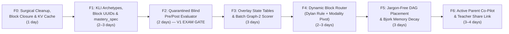
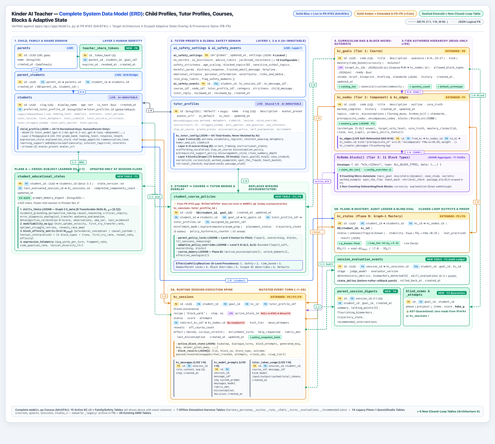
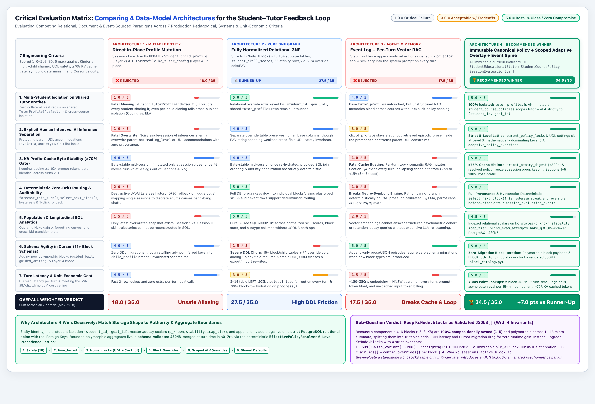
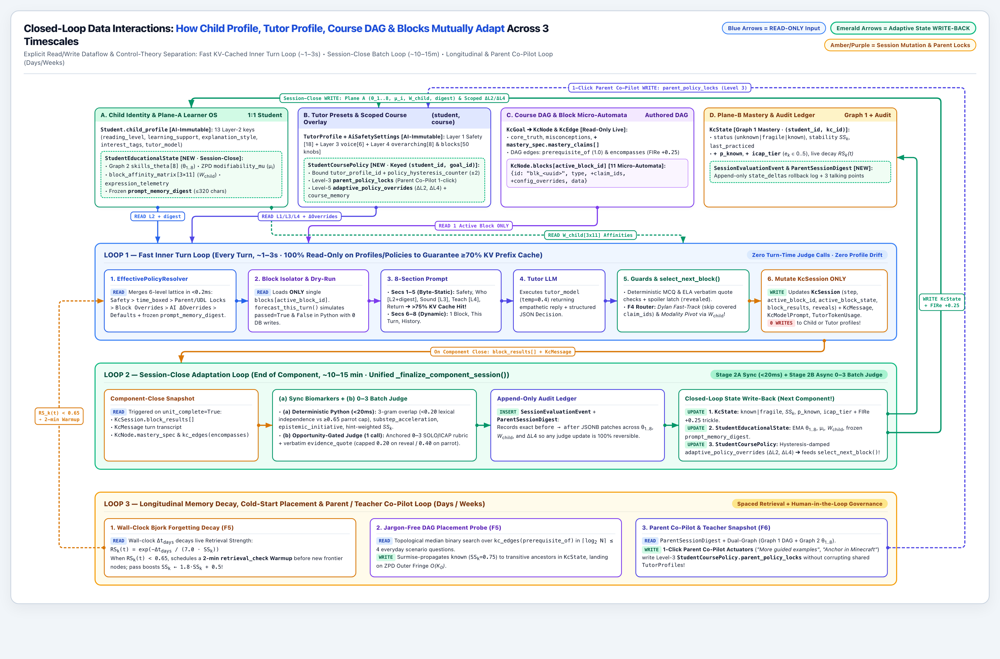

# Kinder AI Teacher — System Architecture, Closed-Loop Data Model & Sequenced Build Specification (`F0`–`F6`)

* **Repository Baseline Audited:** `mv97hub/aitutor-mvp` at `origin/main` commit `b4c6f4cdb1cce013b11d5e54e955c7c92bbd2287` (**PR #193**)
* **Last Verified:** November 23, 2026
* **Database & Runtime Stack:** PostgreSQL (`postgresql+psycopg`) + SQLAlchemy 2.0 Declarative ORM (`36` ORM tables in [apps/api/app/models.py](../apps/api/app/models.py); `43` Alembic migrations through `043_harness_claim_generation.py`) + FastAPI + Next.js
* **Purpose:** Canonical architectural reference, data-model contract, and sequenced Cursor implementation guide (`F0`–`F6`) for closing the multi-session Personal AI Teacher loop without rewriting the working KC v2 engine.

---

## Table of Contents

1. [Executive Summary & Direct Answers to Key Architecture Questions](#1-executive-summary--direct-answers-to-key-architecture-questions)
2. [Codebase Audit: What to KEEP, EXTEND, and QUARANTINE (`b4c6f4c`)](#2-codebase-audit-what-to-keep-extend-and-quarantine-b4c6f4c)
3. [System Data Model & Entity-Relationship Architecture (ERD)](#3-system-data-model--entity-relationship-architecture-erd)
4. [Critical Evaluation of Data-Model Paradigms & Recommended Architecture (`34.5 / 35.0`)](#4-critical-evaluation-of-data-model-paradigms--recommended-architecture-345--350)
5. [Closed-Loop Student–Tutor Data Interactions Across 3 Timescales](#5-closed-loop-studenttutor-data-interactions-across-3-timescales)
6. [Computational Pedagogy Reference: KLI Archetypes, Dual-Graph Mastery & Biomarkers](#6-computational-pedagogy-reference-kli-archetypes-dual-graph-mastery--biomarkers)
7. [Sequenced Feature Specifications & Copy-Paste Cursor Prompts (`F0` → `F6`)](#7-sequenced-feature-specifications--copy-paste-cursor-prompts-f0--f6)
8. [Zero-Downtime Alembic Migration Plan (`044`–`047`) & Working Loop](#8-zero-downtime-alembic-migration-plan-044047--working-loop)

---

## 1. Executive Summary & Direct Answers to Key Architecture Questions

### 1.1 Headline Audit Verdict: How Much Is Built vs. Remaining?

A line-by-line audit of `mv97hub/aitutor-mvp` through **PR #193 (`b4c6f4c`)** against our target **Personal AI Teacher (Computational Pedagogy / State-Space POMDP)** specification shows:

* **Overall Target Architecture Completion:** **`~55% Built` | `~45% Remaining`**.
* **Single-Session Execution Engine & 11 Block Micro-Automata (`84%–98% Built`):** What was built between PR #52 and PR #193 ([kc.py](../apps/api/app/kc.py), [kc_loop.py](../apps/api/app/kc_loop.py), [kc_prompt.py](../apps/api/app/kc_prompt.py), [kc_pipeline.py](../apps/api/app/kc_pipeline.py), [block_catalog.py](../apps/api/app/block_catalog.py), [ai_safety.py](../apps/api/app/ai_safety.py), [token_usage.py](../apps/api/app/token_usage.py), and the 14-persona [harness.py](../apps/api/app/harness.py) runner) is production-grade neuro-symbolic infrastructure (**`~19,500+` lines of active backend Python** plus the Next.js `/learn`, `/kc-studio`, `/kc-progress`, and `/parent` surfaces).
* **Cross-Session Adaptive Brain, Dynamic Routing & Quarantined Evaluation (`16%–25% Built`):** Today, the feedback loop terminates at `kc_states` (`unknown | fragile | known`). What remains is the **closed-loop outer intelligence layer**:
  1. Surgical Wave-1 declutter, seamless mid-component block closing, and KV prefix-cache purity (`F0`).
  2. KLI Subject Archetypes, immutable block UUIDs, and block-independent `KcNode.mastery_spec` (`F1`).
  3. Quarantined Blind Pre/Post Exam Evaluator (`blind_evaluator.py`) computing Hake Normalized Learning Gain $g$ (`F2`).
  4. Persistent Two-Plane Learner State (`student_educational_states` + `student_course_policies` + `session_evaluation_events`) and End-of-Session Batch Graph-2 Scorer (`F3`).
  5. Dynamic Between-Block Router (`select_next_block`: "Dylan Rule" fast-tracking + struggle modality pivot) (`F4`).
  6. Jargon-Free Topological Median DAG Placement (`kc_placement.py`) & Bjork Forgetting-Curve Decay (`F5`).
  7. Active Parent Co-Pilot Dashboard (`/parent`) & Revocable Teacher Snapshot (`/teacher/share/[token]`) (`F6`).

---

### 1.2 Direct Answers to Our Five Core Engineering Questions

#### Q1: *Should we scrap/rewrite `aitutor-mvp` from scratch, or refactor and extend the existing codebase?*
**Verdict: Do NOT rewrite from scratch. Keep the KC v2 core and execute a 1-day surgical cleanup (`Feature 0`) first.**

Our audit pinpointed the exact reasons why the repo simultaneously feels cluttered *and* why block transitions feel `~90%` rather than `100%`:

1. **Why `apps/api/app/` feels cluttered:** Sitting alongside active KC v2 modules are **`6,616+ lines` of dead Wave-1 / Wave-2.0 prototype files** (`studio.py` [`3,804 LOC`], `kc_moves.py` [`1,319 LOC`], `engine/assemble.py` [`1,025 LOC`], and `flow.py` [`468 LOC`]) that have **zero imports** from active KC v2 code. Quarantining them into `apps/api/app/_legacy/` clears the noise in 30 minutes without losing 140 PRs of hard-won deterministic turn guards in `kc_loop.py` and `kc_prompt.py` (`forecast_this_turn`, side-question pausing, blank/echo holds, verbatim ELA quote span matching, and sticky `tutor_gave_away_answer` detection).
2. **Why block closing and `topic_goal` feel `~90%` (4 specific code bugs identified):**
   * **Friction A — Redundant `summary_check` on 8 of 11 blocks (`kc_prompt.py:328–360`, `kc_loop.py:2255, 2337`):** `passage_ela`, `worked_example`, and `explanation` already bypass mid-component `summary_check`, which is why they close crisply. The remaining **8 block types** (`topic_goal`, `mcq`, `case_study`, `socratic`, `curiosity`, `spot_the_flaw`, `teach_back`, `retrieval_check`) still force `_enter_summary(revealed=False)` (`"Any questions before we move on?"`) on every mid-component block—adding 3–5 unnecessary confirmation turns per component.
   * **Friction B — Double-Explaining on `explanation -> topic_goal`:** Because `explanation` (`PR #110`) teaches the concept and `topic_goal` (`PR #143`) opens at substep `"explain"`, chaining `explanation -> topic_goal` explains the exact same concept twice in a row before asking a question.
   * **Bug C — Unconditional `passage_ela` Auto-Injection (`kc_model.py:511–568`):** Whenever `"passage_ela"` is enabled in `allowed_block_types` (the default in `models.py`), `_passage_scope_lines()` forces a `passage_ela` block (or a hardcoded `"brass key"` fallback passage at `kc_model.py:426`) into *every* component of *every* course—even in AP Psychology or Coding.
   * **Bug D — Discarded Knobs & Prefix-Cache Churn in `kc_prompt.py`:** `kc_prompt.py:3095` executes `del check_in, summary_style`; `kc_prompt.py:3980` executes `del stability`; `kc_prompt.py:2713–2718` hardcodes an economics `"scarcity"` misconception inside `teach_back`; and Sections 4 (`_how_to_teach`) and 5 (`_what_to_return`) mutate on per-turn flags, busting KV prefix-cache hits.

---

#### Q2: *Should we pare down to 2 block types for MVP, or keep all 11?*
**Verdict: Keep all 11 validated block schemas in `block_catalog.py`, eliminate the shared `summary_check` friction across all of them in `F0`, and constrain course authoring via Subject Archetype "Golden Recipes" (`4–5` blocks per component) in `F1`.**
* Paring down to 2 blocks would break domain validity across Math/Coding (`worked_example`, `spot_the_flaw`), Causal Science (`case_study`, `teach_back`), and ELA/History (`passage_ela`, `socratic`). Constraining each component via its KLI Archetype recipe delivers a tight, predictable 4–5 block lesson without deleting working state machines.

---

#### Q3: *How much adaptation should happen mid-session vs. at session close?*
**Verdict: Strictly separate the Fast Inner Turn Loop (`~1–3s`) from the End-of-Component Batch Loop (`~10–15m`):**
* **Mid-Session (`Loop 1` — `F4`):** Zero profile/policy DB writes, zero LLM judge calls, and zero mutations to Prompt Sections 1–5 (protecting `>75%` KV prefix-cache hit rates). Adaptation mid-session happens *only* at **block boundaries** via deterministic Python `select_next_block()` (skipping redundant lower-ICAP blocks on high-confidence first-try passes, or pivoting modality after a `revealed` block).
* **End-of-Session (`Loop 2` — `F3`):** Unified `_finalize_component_session()` runs `<20ms` deterministic telemetry + `1` asynchronous high-reasoning batch evaluation over the finished transcript to update Graph-2 skills ($\theta_{1..8}$), modality affinities ($W_{\text{child}}$), hysteresis-damped course policy deltas ($\Delta\text{L2}, \Delta\text{L4}$), and a frozen $\le 320$-char `prompt_memory_digest` for the *next* component.

---

#### Q4: *How do we score the 8 Graph-2 Thinking Skills and 4 Biomarkers without LLM hand-waving?*
**Verdict: Opportunity Gating + Deterministic Python Ceilings + Verbatim-Evidence `0–3` Anchored Rubrics:**
1. **Deterministic Opportunity Gate:** A session may *only* update skill $\theta_m$ if the learner completed a counting block substep mapped to $\theta_m$ in `BLOCK_SKILL_WEIGHTS` (non-exercised skills are untouched).
2. **Hard Anti-Hallucination Caps (Pre-Judge):** Revealed blocks (`outcome == "revealed"` or `answer_given_away == True`) cap $y_m \le 0.20$; parroted responses (`>= 0.65` 3-gram overlap against prior tutor turns) cap $y_m \le 0.40$.
3. **Anchored `0–3` SOLO/ICAP Rubric + Confidence-Weighted EMA:** Eligible unrevealed blocks are scored `0..3` with a mandatory verbatim `evidence_quote` and `kc_messages.seq`, updating $\theta_m$ smoothly via confidence-weighted EMA and logging a reversible `before -> after` patch in `session_evaluation_events`.

---

#### Q5: *What is our concrete "Version 1" proof gate and build order?*
**North-Star "Version 1" Gate:** Trishan and Myuran each pick an unfamiliar topic, complete the course end-to-end, and sit a **Quarantined Blind Pre/Post Exam** (`F2`) synthesized strictly from `KcGoal` standards and `KcNode` (`title`, `description`, `core_truth`, `mastery_spec`) with AST-enforced zero access to `KcNode.blocks` or `kc_sessions`, targeting **Hake Normalized Gain $g \ge 0.45$**—followed by running the same protocol with Thomas and Dylan.



---

## 2. Codebase Audit: What to KEEP, EXTEND, and QUARANTINE (`b4c6f4c`)

### 2.1 Dead Wave-1 / Wave-2.0 Modules to QUARANTINE in `F0` (`6,616+` LOC)

Moving these unused files to `apps/api/app/_legacy/` (and gating legacy v1 mounts behind `ENABLE_LEGACY_V1=false` in [apps/api/app/main.py](../apps/api/app/main.py)) removes dead prototype paths without touching active KC v2 code:

| Dead / Superseded File | LOC | Legacy Role | Verification Proof That KC v2 Does Not Use It |
| :--- | :---: | :--- | :--- |
| [apps/api/app/studio.py](../apps/api/app/studio.py) + [routes/studio.py](../apps/api/app/routes/studio.py) | `4,169` | Wave-1 4-phase flat Quest builder (`/create-course`, `studio_courses`) | Superseded by `kc_pipeline.py` + `kc_course_draft.py` (`/kc-studio`). Zero imports from `kc*.py`. |
| [apps/api/app/kc_moves.py](../apps/api/app/kc_moves.py) | `1,319` | Retired Wave-2.0 fixed 5-type 3-move recipes | Columns dropped in migration `025_kc_blocks_and_configs.py`; `KcSession` always sets `recipe = "block_walk"` (`kc.py:3228`). Also prune dead `resolve_decision` fallback (`kc_loop.py:2757–2935`). |
| [apps/api/app/engine/assemble.py](../apps/api/app/engine/assemble.py) | `1,025` | Wave-1 7-layer Quest prompt compiler | Superseded by `kc_prompt.py` (`build_kc_prompt`). Zero imports from `kc*.py`. |
| [apps/api/app/flow.py](../apps/api/app/flow.py) + [widgets.py](../apps/api/app/widgets.py) + [routes/sessions.py](../apps/api/app/routes/sessions.py) | `~950` | Wave-1 Quest turn scorer & close widgets | Superseded by `kc_loop.py` (`resolve_block_turn`, `match_mcq_choice_index`) & `routes/kc.py`. |

### 2.2 Active KC v2 Modules to KEEP & EXTEND (`~19,500+` LOC Core IP)

| Active KC v2 Module | LOC | Verdict | Why We Keep It & Planned Surgical Extensions |
| :--- | :---: | :--- | :--- |
| [block_catalog.py](../apps/api/app/block_catalog.py) + [kc_blocks.py](../apps/api/app/kc_blocks.py) | `663` | **KEEP (`98%` complete)** | Strict JSON schemas for all 11 block types + Common Core ELA passage scaling & quote span matching. **Extend (`F1`):** Add `KLI_ARCHETYPES`, `BLOCK_ICAP_TIERS`, and `BLOCK_SKILL_WEIGHTS`. |
| [kc_loop.py](../apps/api/app/kc_loop.py) | `2,935` | **KEEP & EXTEND** | Houses `forecast_this_turn` (`L2676`), `resolve_block_turn` (`L1768`), side-question holds (`L1954`), blank/non-answer holds (`L970, L1726`), MCQ/ELA deterministic checks (`L69, L1457`), and sticky `tutor_gave_away_answer` (`L2505`). **Extend (`F0`, `F4`):** Bypass mid-component `summary_check` on clean passes, deduplicate `explanation -> topic_goal`, add `select_next_block()`, re-enable `redirect_kc_id`, and prune `resolve_decision`. |
| [kc_prompt.py](../apps/api/app/kc_prompt.py) | `4,383` | **KEEP & EXTEND** | 8-section `_SECTION_ORDER` (`L3800`), `_align_this_turn` (`L2177`), single-block isolation (`_what_to_teach`, `L2471`), and token budget fitter (`_fit_prompt_sections`, `L3851`). **Extend (`F0`, `F3`, `F4`):** Fix `del check_in, summary_style` (`L3095`), `del stability` (`L3980`), hardcoded scarcity line (`L2713`), move turn-volatile branches out of Sections 4 & 5 into Section 7, add `"bored"` / `"curious_stretch"` to `AFFECTS` (`L44`), and inject frozen `prompt_memory_digest` into Section 2 (`L929`). |
| [kc_pipeline.py](../apps/api/app/kc_pipeline.py) + [kc_model.py](../apps/api/app/kc_model.py) + [kc_standards.py](../apps/api/app/kc_standards.py) | `3,144` | **KEEP & EXTEND** | 4-stage authoring pipeline (`brief -> blueprint -> unit -> review`), 100k-char syllabus paste, DAG acyclicity checks, and standards coverage matrix. **Extend (`F1`):** Fix `_passage_scope_lines` (`kc_model.py:511–568`), emit `archetype` + `mastery_spec` before block drafting, mint immutable `blk_<12hex>` IDs, and add server-side batch synthesis. |
| [kc.py](../apps/api/app/kc.py) + [models.py](../apps/api/app/models.py) + [tutor_profile.py](../apps/api/app/tutor_profile.py) | `~8,000` | **KEEP & EXTEND** | Core ORM models, FIRe `ENCOMPASS_WEIGHT = 0.25` (`kc.py:106, 2876`), and tutor endpoints. **Extend (`F1`–`F6`):** Add Architecture 4 overlay tables (`student_educational_states`, `student_course_policies`, `session_evaluation_events`), `EffectivePolicyResolver`, unified `_finalize_component_session()`, `active_block_id` wiring, and Bjork decay $RS_k(t)$. |
| [harness.py](../apps/api/app/harness.py) + `harness_*.py` | `~4,800` | **KEEP & EXTEND** | 14 synthetic child personas (`AI_Child1..14`), `FOR UPDATE SKIP LOCKED` parallel queue, `automatic_checks`, and 14-dim Judge Rubric v2. **Extend (`F2`, `F3`):** Add epistemic-sandbox `blind_evaluator.py` post-test mode and longitudinal multi-session mode (preserving `KcState` across chained sessions). |
| [ai_safety.py](../apps/api/app/ai_safety.py) + [token_usage.py](../apps/api/app/token_usage.py) | `1,028` | **KEEP (`95%` complete)** | 4 hard-locked + 14 configurable child safety guardrails + `TutorTokenUsage` ledger. **Extend (`F0`):** Expose `cache_hit_rate = cached_tokens / max(input_tokens, 1)` in `usage_report()` and update frontier model pricing table (`token_usage.py:141`). |

---

## 3. System Data Model & Entity-Relationship Architecture (ERD)

### 3.1 Complete Table Census in `models.py` (`36` Existing ORM Tables + `6` New Closed-Loop Tables)

`apps/api/app/models.py` currently defines **36 SQLAlchemy tables** across three planes:
* **15 Active KC v2 ("Plane 2") + Shared Family/Safety/Telemetry Tables:** `students`, `parents`, `parent_students`, `tutor_profiles`, `ai_safety_settings`, `ai_safety_events`, `kc_goals`, `kc_nodes`, `kc_edges`, `kc_creator_messages`, `kc_sessions`, `kc_messages`, `kc_model_prompts`, `kc_states`, `tutor_token_usage`.
* **7 Offline Simulation Harness Tables (Admin Eval Only):** `harness_personas`, `harness_suites`, `harness_runs`, `harness_chats`, `harness_turns`, `harness_evaluations`, `harness_recommendations`.
* **14 Legacy Plane-1 Quest & Studio Tables (Quarantined in `F0`):** `courses`, `quests`, `quest_goals`, `quest_closes`, `sessions`, `messages`, `goal_results`, `model_prompts`, `studio_courses`, `studio_quests`, `studio_quest_goals`, `studio_quest_close`, `studio_messages`, `studio_settings`.
* **6 New Architecture-4 Closed-Loop Tables (`F2`–`F6`):** `student_educational_states`, `student_course_policies`, `session_evaluation_events`, `parent_session_digests`, `teacher_share_tokens`, and `blind_exams` (+ `blind_exam_attempts`).



### 3.2 Relational Foreign-Key Spine (`erDiagram`)

```mermaid
erDiagram
    parents ||--o{ parent_students : "links (CASCADE)"
    students ||--o{ parent_students : "linked to (CASCADE)"
    parents ||--o{ teacher_share_tokens : "mints (CASCADE)"
    students ||--o{ teacher_share_tokens : "shared via (CASCADE)"

    tutor_profiles ||--o{ students : "preferred_tutor_profile_id (SET NULL)"
    students ||--|| student_educational_states : "1:1 Plane-A Learner OS (CASCADE)"

    students ||--o{ student_course_policies : "enrolled in (CASCADE)"
    kc_goals ||--o{ student_course_policies : "scopes policy (CASCADE)"
    tutor_profiles ||--o{ student_course_policies : "course tutor_profile_id (SET NULL)"
    parents ||--o{ student_course_policies : "assigned_by_parent_id (SET NULL)"

    kc_goals }o--o{ kc_nodes : "target_kc_ids JSON[]"
    kc_nodes ||--o{ kc_edges : "from_kc / to_kc DAG (CASCADE)"
    kc_nodes ||--|{ kc_node_blocks_jsonb : "blocks[] JSONB (11 types)"

    students ||--o{ kc_sessions : "walks (RESTRICT)"
    kc_goals ||--o{ kc_sessions : "within course (CASCADE)"
    kc_nodes ||--o{ kc_sessions : "teaches component (CASCADE)"
    tutor_profiles ||--o{ kc_sessions : "historical provenance (SET NULL)"

    kc_sessions ||--o{ kc_messages : "transcript seq (CASCADE)"
    kc_sessions ||--o{ kc_model_prompts : "8-sec prompt audit (CASCADE)"
    kc_sessions ||--o{ tutor_token_usage : "KV cache ledger (CASCADE)"
    kc_sessions ||--o{ ai_safety_events : "flagged turns (CASCADE)"

    students ||--o{ kc_states : "owns mastery (RESTRICT)"
    kc_nodes ||--o{ kc_states : "Graph-1 + Bjork SS_k (CASCADE)"

    kc_sessions ||--o{ session_evaluation_events : "before/after rollback diff (CASCADE)"
    kc_sessions ||--o| parent_session_digests : "1:1 dinner-table digest (CASCADE)"
    kc_goals ||--o{ blind_exams : "AST-quarantined pre/post (CASCADE)"
    blind_exams ||--o{ blind_exam_attempts : "Hake gain g (CASCADE)"
```



---

### 3.3 Critical Baseline Bug Uncovered: Missing `KcCourseTutor` Table (`kc.py:1973–2056` & `routes/catalog.py:222–245`)

> **Important Schema Discovery:** There is **no `(student_id, goal_id)` course-tutor binding table** anywhere in `models.py` today!
> * **Current Read (`_course_tutor_id`, `kc.py:1973`):** Scans `kc_sessions` ordered by `updated_at DESC` to find the newest non-null `tutor_profile_id` on `(student.id, goal.id)`, falling back to `student.preferred_tutor_profile_id` -> `TutorProfile("default")`.
> * **Current Write (`bind_course_tutor`, `kc.py:2029`):** Loads **all** `KcSession` rows for `(student.id, goal.id)` and overwrites `row.tutor_profile_id = profile.id` on every single one of them, while `_assign_student_tutor_profile()` (`routes/catalog.py:244`) overwrites `tutor_profile_id` on **every `in_progress` `KcSession` across all courses**.
> * **Three Resulting Bugs Fixed by `student_course_policies`:**
>   1. **Pre-Start Amnesia:** Calling `POST /kc/tutor/courses/{course_id}/tutor` *before* starting any session on Course A writes zero `kc_sessions` rows (only mutating `student.preferred_tutor_profile_id`), so picking a tutor on Course B immediately clobbers Course A's tutor.
>   2. **Cross-Course Overwrite:** Updating a student's global fallback tutor clobbers per-course tutor choices across all active courses.
>   3. **Historical Provenance Destruction:** Switching tutors mid-course rewrites `tutor_profile_id` on already-completed `KcSession` rows, destroying audit provenance of which tutor taught earlier units.
> * **Other Dormant Columns Found in `b4c6f4c`:** `kc_sessions.active_block_id` (`models.py:1140`) is never written (`NULL` on every row); `kc_sessions.redirect_kc_id` (`models.py:1150`) is unreachable because `resolve_block_turn()` hardcodes `redirect=False`; and `KcNode.kc_type` (`models.py:998`) is stored only on transient in-memory `self._kc_type_memory` (always `None` from PostgreSQL).

---

### 3.4 Complete Target Data Element Dictionary (`[LIVE IN PR #193]` · `[EXTENDED]` · `[NEW TABLE]`)

All new/upgraded structured columns use `JSONBCompat = JSON().with_variant(postgresql.JSONB(), "postgresql")`, yielding binary GIN-indexable `jsonb` in PostgreSQL while preserving SQLite compatibility in unit tests.

#### Domain 1: Child Profiles, Family & Plane-A Cross-Course Learner OS

| Table & Badge | Keys & Foreign Keys | Exact Columns & Structured Sub-Schemas | Write Authority |
| :--- | :--- | :--- | :--- |
| **`students`**<br>`[LIVE — AI-IMMUTABLE]` | **PK:** `id` (`UUID`)<br>**UQ:** `slug`<br>**FK:** `preferred_tutor_profile_id` -> `tutor_profiles.id` (`SET NULL`) | • **Scalars:** `display_name`, `age` (`<8`, `8..13`, `>=14` safety scaling), `is_test`, `created_at` *(+ legacy fallback `reading_level`, `modality`, `interests` and unused Plane-1 `tutor_*` cols)*.<br>• **`child_profile` (`JSON`, 13 Normalized Keys):**<br>  1. *Model (1):* `tutor_model` (`gpt-4o-mini`, `gpt-4o`, `gpt-4.1-mini`, `gpt-4.1` [def], `gpt-6.1-sol`, `gpt-6-luna`, `~deepseek/deepseek-flash-latest`).<br>  2. *Layer-2 Pedagogical & UDL (10):* `grade_band` (`early_elementary`..`high_school`), `reading_level` (`emerging`..`advanced`), `response_length` (`bite_sized` \| `balanced` \| `detailed`), `expression_style`, `explanation_style`, `challenge_appetite`, `communication_tone`, `learning_support` (`none` \| `adhd_focus_friendly` \| `dyslexia_reading_friendly` \| `ell_language_support` \| `math_or_test_anxiety`), `interest_tags` (`<=4` of 10 tags), `interests` (`<=120` chars).<br>  3. *Avatar (2):* `avatar_preset`, `avatar_url`. | **Human Parent / Learner / Admin UI ONLY.** Never mutated by AI evaluators. |
| **`parents`** & **`parent_students`**<br>`[LIVE IN PR #193]` | `parents.id` (`UUID` PK)<br>`uq_parent_students_pair (parent_id, student_id)` (`CASCADE`) | • `parents`: `id` (URL capability token), `name`, `created_at`.<br>• `parent_students`: `M:N` join between parents and non-test learners (`is_test == False`). | Family onboarding & linking routes. |
| **`student_educational_states`**<br>`[NEW TABLE — F3 Plane A]` | **PK & FK:** `student_id` -> `students.id` (`Strict 1:1`, `CASCADE`)<br>**FK:** `last_evaluated_session_id` -> `kc_sessions.id` (`SET NULL`) | • **Scalars:** `state_version` (`int`), `completed_components_count` (`int`), `updated_at`, **`prompt_memory_digest`** (`String(400)`, `<=320` chars — **frozen mid-session**, appended to Prompt Section 2).<br>• **`skills_theta` (`JSONB` — Graph 2):** 8 transferable skills (`evidence_grounding`, `perspective_taking`, `causal_reasoning`, `critical_inquiry`, `error_diagnosis`, `analogical_transfer`, `audience_explanation`, `metacognitive_calibration`) -> `{score, observations, ema_var, last_session_id, last_evidence, updated_at}`.<br>• **`modifiability_mu` (`JSONB`):** `{hint_uptake_velocity, first_try_transfer_rate, optimal_struggle_retries, reveals_rate_ema}`.<br>• **`block_affinity_matrix` (`JSONB` — $3 \times 11$ $W_{\text{child}}$):** `{procedural_conceptual, causal_systems, textual_interpretive}` $\times$ 11 `ALL_BLOCK_TYPES` -> `{runs, first_try_rate, reveal_rate, affinity}`.<br>• **`expression_telemetry` (`JSONB`):** `{avg_words_per_turn, fragment_rate, side_question_rate, lexical_diversity_ttr}`. | **Loop 2 Session-Close ONLY** (`_finalize_component_session`). **100% Read-Only during Loop 1 turns.** |

#### Domain 2: Tutor Presets, Safety & Student-Course Policy Bridge

| Table & Badge | Keys & Foreign Keys | Exact Columns & Structured Sub-Schemas | Write Authority |
| :--- | :--- | :--- | :--- |
| **`tutor_profiles`**<br>`[LIVE — AI-IMMUTABLE]` | **PK:** `id` (`String(120)`, `"default"` + custom slugs)<br>**UQ:** `slug` | • **Scalars:** `name`, `description`, `avatar_preset`, `avatar_url`, `is_default`, `is_test`, mirrored Layer-3 cols (`persona`, `metaphors`, `sidekick`, `lexicon`, `voice_override`, `use_interests`), `updated_at`.<br>• **`kc_tutor_config` (`JSON`, 64 Total Knobs):**<br>  1. *`voice` (6 Layer-3 keys):* `persona` (`coach`, `socratic_mentor`, `detective`, `explorer`, `storyteller`, `sibling`, `wizard`), `vocabulary_register`, `interest_weaving`, `metaphors`, `humor_and_wit`, `sidekick`.<br>  2. *`overarching` (8 Layer-4/5/6 keys):* `orient_framing`, `instructional_stance`, `scaffolding_escalation`, `stay_on_course`, `misconception_policy`, `prerequisite_support_policy`, `encouragement_style`, `close_summary_depth`.<br>  3. *`blocks` (11 schemas, 50 typed knobs validated by `BLOCK_CONFIG_SPECS`):* `topic_goal(6)`, `mcq(5)`, `case_study(4)`, `socratic(4)`, `curiosity(4)`, `worked_example(4)`, `spot_the_flaw(4)`, `teach_back(4)`, `retrieval_check(4)`, `explanation(6)`, `passage_ela(5)`. | **Preset Author / Admin ONLY.** Shared `1:N` across students; never mutated by AI. |
| **`ai_safety_settings`** & **`ai_safety_events`**<br>`[LIVE IN PR #193]` | `ai_safety_settings.id = 'global'`<br>`ai_safety_events.id` (`UUID` PK) | • `ai_safety_settings`: 4 hard-locked invariants (`no_secrets`, `ai_disclosure`, `advice_limits`, `jailbreak_resistance`) + 14 configurable guardrails (`safety_strictness`, `age_scaling`, `blocked_topics[8]`, `distress_response`, `helpline`, etc.).<br>• `ai_safety_events`: Immutable incident log (`distress`, `inappropriate_content`, `personal_info`, `manipulation`, `other`). | Admin Safety UI (`settings`); Loop 1 turn guard (`events`). |
| **`student_course_policies`**<br>`[NEW TABLE — F3/F6]`<br>*(Replaces missing `KcCourseTutor`)* | **PK:** `id` (`UUID`)<br>**UQ:** `(student_id, goal_id)`<br>**FKs:** `student_id`, `goal_id`, `tutor_profile_id` (`SET NULL`), `assigned_by_parent_id` | • **Scalars:** `enrollment_mode` (`explore` \| `mastery` \| `exam_prep`), `placement_status` (`unstarted` \| `skipped_start_beginning` \| `completed`), `trajectory_state` (5 states), **`policy_hysteresis_counter`** (`int`, requires $\pm 2$ consecutive aligned sessions before shifting discrete Layer-4 enums).<br>• **`parent_policy_locks` (`JSONB` — Level 3):** Explicit 1-click Parent Co-Pilot locks (`layer2`, `overarching`, `blocks`, `ttl_sessions_remaining`, `set_by_parent_id`).<br>• **`adaptive_policy_overrides` (`JSONB` — Level 5):** Bounded AI $\Delta\text{L2}_{\text{soft}}$ & $\Delta\text{L4}$ deltas scoped strictly to `(student_id, goal_id)`.<br>• **`course_memory` (`JSONB` — Plane B):** `{active_misconceptions[{wrong_move, broken_kc, hits, resolved}], unlock_moments[], effective_analogies[]}`. | Course tutor picker (`tutor_profile_id`), Parent Co-Pilot (`parent_policy_locks`), and Loop 2 Close (`adaptive_policy_overrides`, `course_memory`). |

#### Domain 3: Curriculum Hierarchy (`Course` -> `Component DAG` -> `11 Block Micro-Automata`)

| Table & Badge | Keys & Foreign Keys | Exact Columns & Structured Sub-Schemas | Pedagogical Role |
| :--- | :--- | :--- | :--- |
| **`kc_goals`** *(Course)*<br>`[EXTENDED — F6]` | **PK:** `id` (`UUID`)<br>**UQ:** `code`<br>**Logical FK:** `target_kc_ids` (`JSON` ordered list of `kc_nodes.id`) | • **Live (`PR #193`):** `title`, `description`, `audience` (`6-8`, `9-11`, `12-14`, `15-17`), `kind` (`mastery` \| `time_boxed` \| `curiosity`), `minutes`, `target_kc_ids`, `allowed_block_types`, `intake`, `brief`, `blueprint`, `drafting`, `standards`, `ready`, `history`.<br>• **Added (`F6`):** `catalog_tier` (`canonical` \| `custom` \| `community`), `upvotes_count`, `default_archetype`. | **Tier 1:** Syllabus envelope, standards alignment, and target component list. |
| **`kc_nodes`** *(Component)* & **`kc_edges`** *(DAG)*<br>`[EXTENDED — F1]` | `kc_nodes.id` (`UUID` PK), `code` (`UQ`)<br>`kc_edges`: `UQ(from_kc, to_kc, kind)` (`CASCADE`) | • **Live (`PR #193`):** `title`, `description`, `outline`, `core_truth`, `rubric`, `misconceptions` (`[{wrong_move, broken_kc}]`), `standards`, `prerequisite_codes`, `encompasses_codes`, `blocks` (`BlockList` upgraded to `JSONBCompat`), `marked_complete`.<br>• **`kc_edges`:** `kind = 'prerequisite_of'` (`weight=1.0`) vs. `'encompasses'` (`weight=0.25` FIRe trickle).<br>• **Added (`F1`):** **`mastery_spec` (`JSONB`)** — `{archetype, target_solo_level, core_truth, mastery_claims[{id, claim, min_icap}], primary_skills_theta[]}`. | **Tier 2:** Atomic Knowledge Component, backward-designed mastery contract, and DAG edges. |
| **`KcNode.blocks[i]`** *(11 Block Types)*<br>`[JSONB AGGREGATE — F1]` | **Immutable ID:** `id = "blk_<12hex>"` (`F1` upgrade from positional `"blk_1"`) | • **Envelope:** `{id, type, claim_ids: list[str], config_overrides: dict, data: dict}`.<br>• **9 Counting Mastery Types:** `topic_goal`, `mcq` (`static` \| `dynamic`), `case_study`, `socratic`, `worked_example`, `spot_the_flaw`, `teach_back`, `retrieval_check`, `passage_ela`.<br>• **2 Non-Counting Hook/Onboarding Types:** `curiosity`, `explanation` (`outcome="engaged"` by default). | **Tier 3:** Substep micro-automata (`substeps_for_block`) driving each interactive turn. |

#### Domain 4: Runtime Sessions, Mastery State, Provenance Ledger & Quarantined Evaluation

| Table & Badge | Keys & Foreign Keys | Exact Columns & Structured Sub-Schemas | Role in Closed Loop |
| :--- | :--- | :--- | :--- |
| **`kc_sessions`** `[EXTENDED]` + `kc_messages`, `kc_model_prompts`, `tutor_token_usage` `[LIVE]` | **PK:** `id` (`UUID`)<br>**FKs:** `student_id`, `goal_id`, `kc_id`, `tutor_profile_id` *(frozen provenance)*, `redirect_kc_id` | • **State Machine:** `step`, **`active_block_id`** *(wired in `F0`/`F1`)*, `active_block_state` (`substep`, `block_attempts`, `generated_mcq`, `answer_given_away`), `block_results` (`passed` \| `revealed` \| `engaged` \| **`fast_tracked`** + `claim_ids`, `icap_tier`).<br>• **Diagnostics:** `status`, `score`, `attempts`, `hint_tier`, `move_attempts`, `reveals`, **`redirect_kc_id`** *(re-enabled in `F4`)*, `affect` (+ `bored`, `curious_stretch`), `last_misconception`, **`policy_snapshot_hash`**. | **Loop 1 Turn Spine:** Only domain written during live turns; tracks KV `cached_tokens / input_tokens`. |
| **`kc_states`**<br>`[EXTENDED — F3/F5]` | **PK:** `id` (`UUID`)<br>**UQ:** `(student_id, kc_id)` | • **Live (`PR #193`):** `status` (`unknown` \| `fragile` \| `known`), `stability` ($SS_k$ Float + `+0.25` FIRe), `last_practiced`, `result` (`JSONB`).<br>• **Added (`F3`/`F5`):** **`p_known`** (`Float 0..1`), **`icap_tier`** (`Int 0..5`), composite index `(student_id, status, last_practiced)`. | **Plane-B Graph 1:** Honest mastery (`revealed` -> `fragile`, $e_k \le 2$) + Bjork forgetting decay $RS_k(t)$. |
| **`session_evaluation_events`**<br>`[NEW TABLE — F3 Audit]` | **PK:** `id` (`UUID`)<br>**FKs:** `session_id`, `student_id`, `goal_id`, `kc_id` | • `stage` (`deterministic_sync` \| `full_batch_judged`), `deterministic_metrics`, `biomarkers_detected`, `skill_evaluations` (`0..3` rubric + verbatim `evidence_quote` + `evidence_message_seq`), **`state_deltas`** (exact `before -> after` JSONB patch across $\theta_{1..8}$, $W_{\text{child}}$, $\Delta\text{L4}$, digest), `rolled_back_at`. | **Append-Only Audit & 1-Command Rollback Ledger** for every AI adaptation. |
| **`parent_session_digests`**, **`teacher_share_tokens`**, **`blind_exams`** & **`blind_exam_attempts`**<br>`[NEW TABLES — F2/F6]` | `parent_session_digests`: `UQ(session_id)`<br>`blind_exams`: `FK(goal_id)` | • `parent_session_digests`: `summary`, `talking_points[3]`, `flourishing_biomarkers`, `trajectory_state`, `recommended_interventions`.<br>• `teacher_share_tokens`: `token_hash` (`SHA-256`), `expires_at`, `revoked_at`.<br>• `blind_exams` / `_attempts`: AST-quarantined items + `paired_pre_score` + `hake_g`. | **Loop 3 Human Co-Pilot** (`/parent`, `/teacher`) & **Objective Learning Proof** ($g \ge 0.45$). |

---

## 4. Critical Evaluation of Data-Model Paradigms & Recommended Architecture (`34.5 / 35.0`)

Designing a closed-loop AI teacher schema requires balancing four fundamental systems constraints:
1. **Aliasing & Shared Mutable State Hazard:** `TutorProfile("default")` is shared `1:N` across students. Mutating it in place corrupts every other student using that preset.
2. **Explicit Human Intent vs. Noisy Machine Inference:** Parent-set UDL accommodations (`dyslexia_reading_friendly`, `math_or_test_anxiety`) must never be overwritten by single-session AI guesses.
3. **3NF Relational Integrity vs. Aggregate Boundary Agility:** Entity isolation `(student_id, goal_id)` needs strict Foreign Keys, whereas polymorphic `KcNode.blocks` (`11–13` distinct schemas always loaded as a `~3–8 KB` unit) suffer severe `JOIN` and DDL migration drag if shredded into 15+ tables.
4. **Control-Loop Timescale Separation & Prefix-Cache Invariance:** Keeping leading system-prompt bytes 100% identical mid-session cuts LLM input costs by `50%–90%` (`>75%` KV cache hits, keeping monthly inference within `USD 6–8`/student).



### 4.1 Summary of the Four Evaluated Architectures

* **Architecture 1 — Direct In-Place Profile Mutation (`18.0 / 35.0` — REJECTED):** Directly updating `students.child_profile` and `tutor_profiles.kc_tutor_config` on session close causes cross-student corruption on `TutorProfile("default")`, intra-child cross-course thrashing (e.g., advanced Python vs. novice ELA), silent erasure of parent UDL accommodations, zero rollback history, and bang-bang enum oscillation.
* **Architecture 2 — Pure 3NF Relational Decomposition (`27.5 / 35.0` — RUNNER-UP):** Normalizing entity boundaries is right, **but shredding `KcNode.blocks` into 15+ polymorphic subtype tables and 74 override columns/EAV is an over-normalization trap**—inflicting `8–14` per-turn `JOIN`s and multi-table Alembic DDL churn every time Cursor adds a block field or introduces Block #12 (`guided_build`).
* **Architecture 3 — Append-Only Event Log + Per-Turn Vector RAG (`17.5 / 35.0` — REJECTED):** Injecting top-$k$ retrieved episodic prose into early prompt sections mutates prompt bytes on every turn—collapsing KV prefix-cache hit rates from `>75%` to `<15%` (`3x–5x` cost surge) and breaking deterministic Python turn forecasting (`forecast_this_turn()`) and Bjork decay math.
* **Architecture 4 — Immutable Canonical Policy + Scoped Adaptive Overlay + Relational Event Spine (`34.5 / 35.0` — RECOMMENDED WINNER):**
  * **Tier I (AI-Immutable Canonical Entities):** `kc_goals`, `kc_nodes` (+ `mastery_spec` and `JSONB` `blocks[]` with permanent `blk_<12hex>` UUIDs), `kc_edges`, `tutor_profiles`, `ai_safety_settings`, and `students.child_profile` are **never mutated by AI**.
  * **Tier II (Scoped Session-Boundary Overlays):** `student_educational_states` (`1:1` Plane A + session-frozen `prompt_memory_digest` $\le 320$ chars) and `student_course_policies` (`UNIQUE(student_id, goal_id)` binding `tutor_profile_id` + Level-3 `parent_policy_locks` + hysteresis-damped Level-5 `adaptive_policy_overrides` + Plane-B `course_memory`).
  * **Tier III (Relational Mastery & Append-Only Rollback Spine):** `kc_states` (`p_known`, `stability`, `icap_tier`) + immutable `session_evaluation_events` recording exact `before -> after` JSONB patches.

### 4.2 The Deterministic 6-Level `EffectivePolicyResolver` Precedence Lattice

At turn time (and inside `forecast_this_turn()`), `EffectivePolicyResolver` merges all configuration layers in `<0.2ms` of pure Python using a strict priority ordering:

1. **Level 1 (Highest) — Global Child Safety Invariants:** `ai_safety_settings('global')` (4 locked + 14 guardrails, scaled by `students.age`).
2. **Level 2 — Course Structural Mode:** `kc_goals.kind == "time_boxed"` (`1` retry cap, `brief_hook`, `concise` close).
3. **Level 3 — Explicit Human Locks:** `students.child_profile` UDL accommodations (`learning_support`, parent-set `reading_level`) + `student_course_policies.parent_policy_locks`. *(E.g., when dyslexia or anxiety support is active, Level 5 AI overrides are forbidden from raising `response_length` above `"balanced"` or enabling banter.)*
4. **Level 4 — Authored Block Overrides:** `KcNode.blocks[i].config_overrides` set by the course author.
5. **Level 5 — Scoped AI Adaptive Overrides:** `student_course_policies.adaptive_policy_overrides` ($\Delta\text{L2}_{\text{soft}}, \Delta\text{L4}$) tuned for `(student_id, goal_id)`.
6. **Level 6 (Base) — Shared Preset Defaults:** `TutorProfile.kc_tutor_config` + `default_child_profile`.

### 4.3 Sub-Question Verdict: Keep `KcNode.blocks` as Typed `JSONB` (Upgraded with 4 Invariants)

Keep `KcNode.blocks` as a schema-validated `JSONB` array on `kc_nodes` rather than splitting into 15 relational block tables, upgraded with:
1. `JSON().with_variant(JSONB(), "postgresql")` + optional GIN index (`jsonb_path_ops`).
2. Permanent `blk_<12hex>` UUIDs minted at block creation (`kc_course_io.py:120`, `kc_prompt.py:264`), retiring positional `"blk_1"` defaults on new blocks while preserving existing IDs referenced in `block_results`.
3. Per-block `claim_ids: list[str]` and `config_overrides: dict`.
4. Active wiring of `kc_sessions.active_block_id` on `open_session()` (`kc.py:3223`) and `apply_decision()` (`kc.py:4215`).

*(Future re-evaluation trigger: extract a standalone `kc_blocks` table if and only if Kinder later introduces an `M:N` shared 50,000-item psychometric bank across courses.)*

---

## 5. Closed-Loop Student–Tutor Data Interactions Across 3 Timescales



### Loop 1: Fast Inner Turn Loop (`Every Turn, ~1–3s` — Prefix-Cache-Pure)
* **Read-Only Inputs:** `EffectivePolicyResolver` merges Layers 1–4 + frozen `prompt_memory_digest`; `_what_to_teach()` loads **only** `kc_nodes.blocks[active_block_id]`; `forecast_this_turn()` simulates `passed=True` and `passed=False` (including `select_next_block()`) with zero DB writes. Prompt Sections 1–5 remain 100% byte-identical across turns within the same block type (`>75%` KV cache hit rate).
* **Post-LLM Deterministic Guards:** Enforces MCQ choice matching, ELA verbatim quote matching, non-answer/side-question holds, sticky `tutor_gave_away_answer` -> `outcome = "revealed"`, and `select_next_block()` transitions.
* **Strictly Session-Scoped Writes:** Mutates *only* `kc_sessions`, `kc_messages`, `kc_model_prompts`, `tutor_token_usage`, and conditional `ai_safety_events`.

### Loop 2: Session-Close Adaptation Loop (`End of Component, ~10–15m` — Unified `_finalize_component_session()`)
Replaces split closure logic across `apply_decision()` (`kc.py:4193–4227`) and `_close_finished_walk()` (`kc.py:2316–2340`) with one unified hook:
* **Stage 2A (`<20ms` Synchronous Python, Zero LLM Cost):** Computes 3-gram overlap (`<0.20` `lexical_independence` vs. `>=0.65` parrot cap), `substep_acceleration`, `epistemic_initiative`, and `trajectory_state`; writes `kc_states` (`known | fragile`, hint-weighted $SS_k$, `p_known`, `icap_tier` $e_k$, plus `+0.25` FIRe trickle onto encompassed ancestors); updates `student_educational_states` ($W_{\text{child}}$, $\mu_i$, `expression_telemetry`); and updates `student_course_policies` (`course_memory`, `parent_policy_locks` TTL decrement, and $\pm 2$-streak hysteresis-damped `adaptive_policy_overrides`).
* **Stage 2B (`1` Async High-Reasoning Call Post-Close):** Opportunity-gates evaluation to the `1–3` exercised Graph-2 skills, applies hard reveal (`0.20`) and parrot (`0.40`) ceilings, grades `0–3` SOLO/ICAP rubrics with mandatory verbatim `evidence_quote` + `kc_messages.seq`, logs a full `before -> after` diff in `session_evaluation_events`, updates `skills_theta` via EMA, freezes the next session's `prompt_memory_digest`, and inserts `parent_session_digests`.

### Loop 3: Longitudinal Decay, DAG Placement & Parent Co-Pilot (`Days / Weeks`)
* **Wall-Clock Bjork Decay (`F5`):** Computes live retrieval strength $RS_k(t) = \exp(-\Delta t_{\text{days}} / (7.0 \cdot SS_k))$; triggers a 2-minute `retrieval_check` warmup when $RS_k(t) < 0.65$, boosting $SS_k \leftarrow 1.8 \cdot SS_k + 0.5$ on pass.
* **Jargon-Free DAG Placement (`F5`):** Binary-searches `kc_edges(prerequisite_of)` in $\lceil \log_2 N \rceil \le 4$ everyday scenarios and surmise-propagates `known` ($SS_k = 0.75$) to ancestors.
* **Parent Co-Pilot Actuators (`F6`):** 1-click interventions on `/parent` write Level-3 `student_course_policies.parent_policy_locks` without mutating shared `tutor_profiles`.

---

## 6. Computational Pedagogy Reference: KLI Archetypes, Dual-Graph Mastery & Biomarkers

### 6.1 Subject / Knowledge Archetypes & Golden Block Recipes (`KLI_ARCHETYPES`)

| Archetype Enum (`KcNode.mastery_spec.archetype`) | Target Domains / Components | Primary Failure Mode Prevented | Default Ordered Golden Block Recipe |
| :--- | :--- | :--- | :--- |
| `procedural_conceptual` *(Primary I)* | Math, Coding, Physics, Formal Logic, Quantitative Econ | Memorizing buggy step rules without structural meaning | `curiosity` -> `explanation` -> `worked_example` -> `spot_the_flaw` -> `mcq` (`dynamic`) |
| `causal_systems` *(Primary II)* | AP Psychology, Macroeconomics, Biology, *"How AI Works"* | Inert definitions; confusing look-alike causal mechanisms | `curiosity` -> `explanation` -> `case_study` *(Contrast A/B + Transfer C)* -> `spot_the_flaw` -> `teach_back` |
| `textual_interpretive` *(Primary III)* | Common Core ELA, GCSE Literature, History, Ethics | Unsubstantiated "vibes" without textual quotes; single-viewpoint bias | `curiosity` -> `passage_ela` *(Idea -> Quote -> Craft)* -> `case_study` -> `socratic` -> `teach_back` |
| `factual_terminological` *(Auxiliary IV)* | Foundational vocabulary, anatomy, notation, timeline anchors | Rapid forgetting & term interference; forced fake dilemmas | `curiosity` -> `explanation` -> `mcq` (`static` or `dynamic`) -> `retrieval_check` |
| `normative_synthesis` *(Auxiliary V)* | Unit capstones, AI Ethics, multi-concept trade-offs | Shallow multiple-choice closure on open trade-offs | `case_study` -> `socratic` *(Thesis -> Counterexamples -> Synthesis)* -> `teach_back` |

### 6.2 Graph-2 Cognitive Primitives (`skills_theta`) & Confidence-Weighted EMA

| Skill Key ($\theta_m \in [0, 1]$, prior `0.50`) | Definition | Opportunity-Gated Block / Substep Evidence Sources (`BLOCK_SKILL_WEIGHTS`) |
| :--- | :--- | :--- |
| `evidence_grounding` ($\theta_1$) | Supporting claims with verbatim quotes or concrete data | `passage_ela:cite_evidence`, `socratic:counterexample_probe` |
| `perspective_taking` ($\theta_2$) | Modeling competing viewpoints or motives fairly | `socratic:counterexample_probe`, `socratic:initial_thesis`, `case_study` (humanities) |
| `causal_reasoning` ($\theta_3$) | Tracing multi-step cause-and-effect mechanisms | `case_study:contrast_and_rule`, `retrieval_check:elaborate_why`, `topic_goal:main` |
| `critical_inquiry` ($\theta_4$) | Testing claims against boundary counterexamples & *"what if"* | `socratic:counterexample_probe`, spontaneous on-topic `why/what-if` questions |
| `error_diagnosis` ($\theta_5$) | Identifying and repairing flawed logic, plans, or code | `spot_the_flaw:critique`, `worked_example` error recovery |
| `analogical_transfer` ($\theta_6$) | Applying an invariant principle to a novel surface scenario | `case_study:transfer`, `worked_example:solo_solve` |
| `audience_explanation` ($\theta_7$) | Explaining complex ideas clearly in own words to a novice | `teach_back:initial_explanation`, `teach_back:peer_follow_up` |
| `metacognitive_calibration` ($\theta_8$) | Alignment between predicted/reported confidence and unassisted accuracy | `curiosity:hook_and_predict`, `retrieval_check:recall`, confidence vs. pass calibration |

**EMA Update Rule (Stage 2B):** Given anchored rubric score $r \in \{0, 1, 2, 3\}$ and capped observation $y_m = \min(\text{ceiling}, r / 3.0)$:

$$\theta_m^{(t+1)} = (1 - \alpha_n)\,\theta_m^{(t)} + \alpha_n \, y_m, \quad \alpha_n = \max\!\left(0.08,\; \frac{1}{n_m + 3}\right)$$

### 6.3 Four Machine-Detectable Flourishing / Unlock Biomarkers (`kc_biomarkers.py`)
1. **`lexical_independence`:** Passed a generative substep (`main`, `contrast_and_rule`, `transfer`, `critique`, `initial_explanation`) with **3-gram overlap `< 0.20`** against prior tutor turns in the block.
2. **`substep_acceleration`:** Required $\ge 1$ retry/hint on Substep 1 (`faded_step` or `contrast_and_rule`), then passed downstream transfer (`solo_solve` or `transfer`) on **Attempt 1 with `hint_tier == "nudge"` (0 escalations)**.
3. **`epistemic_initiative`:** Asked $\ge 1$ on-topic `why / how / what if` question (`learner_side_question == True`, `off_course == False`) during a component that closed as `"known"`.
4. **`multi_perspective_synthesis`:** Passed `socratic:counterexample_probe` or `passage_ela:craft_or_inference` on Attempt 1–2 with batch rubric score `3/3`.

---

## 7. Sequenced Feature Specifications & Copy-Paste Cursor Prompts (`F0` → `F6`)

Each Feature is scoped to **1–3 focused PRs** that preserve 100% test compatibility (`pytest apps/api/tests`) at every step.

---

### Feature 0 (`F0`): Surgical Repo Declutter, Seamless Block Closure & Prefix-Cache Purity
* **Effort:** ~1 day (`kc_loop.py`, `kc_prompt.py`, `kc.py`, `token_usage.py`, `apps/api/app/_legacy/`)
* **Scope:**
  1. Move `studio.py`, `routes/studio.py`, `flow.py`, `widgets.py`, `engine/assemble.py`, and `kc_moves.py` to `apps/api/app/_legacy/` (or guard behind `ENABLE_LEGACY_V1=false`); prune dead `resolve_decision()` (`kc_loop.py:2757–2935`).
  2. Fix `kc_prompt.py`: replace hardcoded `"scarcity"` example in `teach_back` (`L2713–2718`) with `node.misconceptions`; wire `check_in_prompt_style` and `end_of_block_summary_style` instead of `del check_in, summary_style` (`L3095`); remove `del stability` (`L3980`); move turn-volatile branches out of Sections 4 & 5 into Section 7 (`_this_turn`); expose `cache_hit_rate` in `token_usage.py:usage_report()`.
  3. Bypass mid-component `summary_check` (`index < len(blocks) - 1`) on clean unrevealed passes across all 8 remaining block types (`kc_loop.py:2255, 2337`), keeping `summary_check` only on the final block or after a reveal; start `topic_goal` directly at `"main"` when immediately preceded by `explanation`; populate `kc_sessions.active_block_id` on `open_session()` and `apply_decision()`.

#### Cursor Prompt (`F0`)
```text
Read apps/api/app/kc_loop.py, apps/api/app/kc_prompt.py, apps/api/app/kc.py, and apps/api/app/token_usage.py.
Implement Feature 0 in two clean commits:
1. Prompt hygiene, active_block_id wiring & prefix-cache purity:
   - In kc_prompt.py:2713-2718, replace the hardcoded "scarcity" misconception example in teach_back with node.misconceptions[0]["wrong_move"] when present, else a domain-neutral instruction.
   - In kc_prompt.py:3095, wire check_in_prompt_style and end_of_block_summary_style instead of `del check_in, summary_style`, and remove `del stability` at L3980.
   - Move turn-conditional flags out of _how_to_teach() (Section 4) and _what_to_return() (Section 5) into _this_turn() (Section 7) so Sections 1-5 remain byte-identical across turns within the same block type.
   - Populate `session.active_block_id` on `open_session()` (kc.py:3223) and `apply_decision()` (kc.py:4215), and expose `cache_hit_rate = cached_tokens / max(input_tokens, 1)` in `token_usage.py:usage_report()`.
2. Clean mid-component block closure & topic_goal dedup:
   - In kc_loop.py (both resolve_block_turn and forecast_this_turn), when `index < len(blocks) - 1` and a block's final task substep passes cleanly with zero reveals/giveaways, close the block directly and advance to `blocks[index + 1]` without entering `summary_check` (matching `worked_example` at L2330-2336). Keep `summary_check` on the final block (`index == len(blocks) - 1`) or when revealed.
   - When `topic_goal` immediately follows an `explanation` block in `node.blocks`, initialize `topic_goal` directly at `substep = "main"` so the tutor does not explain twice before asking the goal question.
Add/update unit tests in apps/api/tests/ verifying forecast_this_turn and resolve_block_turn stay 100% aligned.
```

---

### Feature 1 (`F1`): KLI Subject Archetype Matrix, Immutable Block UUIDs & `KcNode.mastery_spec`
* **Effort:** 2–3 days (`models.py`, migration `044`, `block_catalog.py`, `kc_pipeline.py`, `kc_model.py`, `kc_course_io.py`)
* **Scope:**
  1. Fix `_passage_scope_lines()` and `draft_scoped_blocks()` (`kc_model.py:511–568`) so `passage_ela` is **only** required/injected when `course_is_ela()` is `True` or `mastery_spec.archetype == "textual_interpretive"` (deleting the unconditional `"brass key"` fallback on non-ELA courses).
  2. Migration `044`: Add `mastery_spec` (`JSONBCompat`, default `{}`) to `kc_nodes` (`models.py:983`); upgrade `KcNode.blocks` to `JSONBCompat` and mint permanent `blk_<12hex>` IDs on new/un-ID'd blocks (`kc_course_io.py:120`, `kc_prompt.py:264`) while preserving existing IDs; preserve per-block `claim_ids: list[str]` and `config_overrides: dict` (merged in `_bcfg()` at `kc_loop.py:125`).
  3. Add `KLI_ARCHETYPES`, `BLOCK_ICAP_TIERS`, and `BLOCK_SKILL_WEIGHTS` to `block_catalog.py`; update `kc_pipeline.py` (`_BLUEPRINT_COMPONENT`) and `kc_model.py` (`creator_bundle`) to emit `mastery_spec` (`archetype`, `target_solo_level`, `mastery_claims[2..3]`, `primary_skills_theta`) *before* synthesizing Golden-Recipe blocks tagged with `claim_ids`; add batch endpoint `POST /kc/goals/{goal_id}/synthesize-all-blocks`.

#### Cursor Prompt (`F1`)
```text
Implement Feature 1 (KLI Archetypes, Immutable Block UUIDs & Block-Independent mastery_spec) across models.py, Alembic migration 044, block_catalog.py, kc_pipeline.py, kc_model.py, kc_course_io.py, kc_prompt.py, and kc_loop.py:
1. Add migration `044_kc_node_mastery_spec_and_block_uuids.py` adding `mastery_spec` (JSON/JSONB, default `{}`) to `kc_nodes`. Mint permanent `blk_<12hex>` IDs when normalizing new blocks lacking stable UUIDs (preserving existing block IDs), and preserve `claim_ids: list[str]` and `config_overrides: dict` per block in `stored_blocks()`, `normalize_blocks()`, and `_bcfg()`.
2. Fix `_passage_scope_lines` and `draft_scoped_blocks` in `kc_model.py:511-568` so `passage_ela` is ONLY required when `course_is_ela()` is True or `mastery_spec.get("archetype") == "textual_interpretive"`.
3. Define `KLI_ARCHETYPES`, `BLOCK_ICAP_TIERS`, and `BLOCK_SKILL_WEIGHTS` in `block_catalog.py` for the 5 archetypes (`procedural_conceptual`, `causal_systems`, `textual_interpretive`, `factual_terminological`, `normative_synthesis`).
4. Update `kc_pipeline.py` blueprint/unit schemas and `creator_bundle()` in `kc_model.py` to populate `KcNode.mastery_spec` before block generation and synthesize blocks following the archetype's Golden Recipe with `claim_ids` mapped to `mastery_spec.mastery_claims`. Add `POST /kc/goals/{goal_id}/synthesize-all-blocks`.
Add unit tests verifying non-ELA courses never receive unsolicited `passage_ela` blocks, ELA courses receive `passage_ela` + `socratic`, and `mastery_spec` + `claim_ids` round-trip through `kc_course_io.py`.
```

---

### Feature 2 (`F2`): Quarantined Blind Pre/Post Evaluator (`blind_evaluator.py`) — V1 Proof Gate
* **Effort:** ~2 days (`blind_evaluator.py`, migration `045`, `models.py`, `routes/kc.py`, `harness.py`, `/learn/.../exam`)
* **Scope:**
  1. **AST-Enforced Quarantine:** `apps/api/app/blind_evaluator.py` may read **only** `KcGoal` (`title`, `description`, `audience`, `standards`) and `KcNode` (`title`, `description`, `core_truth`, `mastery_spec`). Enforce via an AST unit test (`test_blind_evaluator_quarantine.py`) asserting zero imports/reads of `kc_prompt`, `kc_loop`, `KcNode.blocks`, `KcSession`, or `KcMessage`.
  2. Migration `045`: Create `blind_exams` and `blind_exam_attempts` storing isomorphic Pre/Post forms (`40%` deterministic scenario MCQs, `30%` misconception traps, `30%` rubric-keyed short transfer explanations) and computing Hake gain $g = (\text{post} - \text{pre}) / \max(1.0 - \text{pre}, 0.05)$.
  3. Support both human Pre/Post exams (`/learn/[studentId]/course/[courseId]/exam?phase=pre|post`) and `harness.py` epistemic-sandbox mode (where a blank-slate exam agent answers the Post-Test using *only* the tutor's messages from `HarnessChat`).

#### Cursor Prompt (`F2`)
```text
Implement Feature 2 (Quarantined Blind Pre/Post Evaluator):
1. Add migration `045_blind_evaluator_tables.py` creating `blind_exams` and `blind_exam_attempts` in `models.py`.
2. Create `apps/api/app/blind_evaluator.py` + `apps/api/tests/test_blind_evaluator_quarantine.py`. Enforce via Python `ast` inspection that `blind_evaluator.py` never imports `kc_prompt` or `kc_loop` and never accesses `blocks`, `KcSession`, `KcMessage`, or `KcModelPrompt` — reading ONLY `KcGoal` metadata/standards and `KcNode` (`title`, `description`, `core_truth`, `mastery_spec`).
3. Generate isomorphic Pre-Test and Post-Test forms (scenario MCQs graded deterministically + short transfer items graded against a frozen exam rubric key) and compute Hake gain `g = (post - pre) / max(1.0 - pre, 0.05)`.
4. Expose `/kc/tutor/courses/{course_id}/exam` endpoints + `/learn/[studentId]/course/[courseId]/exam` UI, plus `run_blind_post_test=True` in `harness.py` using a blank-slate exam agent restricted strictly to what the tutor taught in the `HarnessChat` transcript.
```

---

### Feature 3 (`F3`): Architecture-4 Overlay Tables, `EffectivePolicyResolver` & End-of-Session Batch Scorer
* **Effort:** ~3 days (migration `046`, `models.py`, `kc_policy_resolver.py`, `kc_biomarkers.py`, `kc_learner_state.py`, `kc.py`, `kc_prompt.py`)
* **Scope:**
  1. Migration `046`: Create `student_educational_states` (`1:1` Plane A), `student_course_policies` (`UNIQUE(student_id, goal_id)` backfilled from `kc_sessions` and replacing session-mutating `_course_tutor_id` / `bind_course_tutor` / `_assign_student_tutor_profile` so historical `kc_sessions.tutor_profile_id` is never overwritten!), and `session_evaluation_events` (append-only provenance & rollback diff ledger). Add `p_known` (`Float`) and `icap_tier` (`Int`) to `kc_states`, and `policy_snapshot_hash` to `kc_sessions`.
  2. Implement the 6-level `EffectivePolicyResolver` (`Safety > time_boxed > Parent/UDL Locks > Block Overrides > Scoped AI ΔOverrides > Defaults`) and inject frozen `prompt_memory_digest` ($\le 320$ chars) at the bottom of Section 2 (`_who_you_are_talking_to`, `kc_prompt.py:929`).
  3. Extract unified `_finalize_component_session(db, session, node)` across `apply_decision()` (`kc.py:4222`) and `_close_finished_walk()` (`kc.py:2316`):
     * **Stage 2A (`<20ms` Sync):** Compute deterministic biomarkers, update `kc_states` (`p_known`, `icap_tier`, hint-weighted $SS_k$), update $W_{\text{child}}$ & $\mu_i$, and apply $\pm 2$-streak hysteresis-damped `adaptive_policy_overrides`.
     * **Stage 2B (`1` Async Batch Call):** Opportunity-gate exercised Graph-2 skills, apply `0.20` reveal / `0.40` parrot ceilings, grade `0..3` SOLO/ICAP rubrics with verbatim `evidence_quote`, write `session_evaluation_events` (`state_deltas`), update `skills_theta` via EMA, and freeze the next `prompt_memory_digest`.

#### Cursor Prompt (`F3`)
```text
Implement Feature 3 (Architecture-4 Scoped Adaptive State Overlays, EffectivePolicyResolver & End-of-Session Batch Scorer):
1. Add migration `046_learner_state_course_policy_and_eval_ledger.py` creating `student_educational_states` (1:1 with `students`), `student_course_policies` (`UNIQUE(student_id, goal_id)` backfilled from `kc_sessions.tutor_profile_id`), and `session_evaluation_events` in `models.py`. Add `p_known` and `icap_tier` to `kc_states`, and `policy_snapshot_hash` to `kc_sessions`.
2. Fix the course-tutor binding bugs in `kc.py:1973-2056` and `routes/catalog.py:222-245`: read/write per-course tutor selection on `student_course_policies.tutor_profile_id` and NEVER retroactively overwrite `tutor_profile_id` on completed `kc_sessions` or across unrelated courses.
3. Implement `EffectivePolicyResolver` enforcing the 6-level precedence lattice (`Safety > time_boxed > Parent/UDL Locks > Block Overrides > AI Adaptive Overrides > Defaults`), and append the session-frozen `prompt_memory_digest` (<=320 chars) to `_who_you_are_talking_to()` in `kc_prompt.py`.
4. Create `kc_biomarkers.py` and `kc_learner_state.py`, wired into a unified `_finalize_component_session()` hook:
   - Stage 2A (sync <20ms): compute 3-gram lexical overlap, biomarkers, `W_child`, `modifiability_mu`, `icap_tier`, and +/-2 streak hysteresis-damped `adaptive_policy_overrides`.
   - Stage 2B (async 1-call batch judge): score ONLY opportunity-gated Graph-2 skills (capped at 0.20 on revealed / 0.40 on >=0.65 parroting) on an anchored 0-3 rubric with verbatim `evidence_quote`, log full `before -> after` diffs in `session_evaluation_events` (with a `rollback_evaluation_event()` helper), update `skills_theta` via EMA, and refresh `prompt_memory_digest`.
Write unit tests covering shared TutorProfile isolation, UDL lock precedence, hysteresis damping, reveal/parrot caps, rollback, and byte-identical Section 2 output across turns.
```

---

### Feature 4 (`F4`): Dynamic Block Policy Router (`select_next_block` in `kc_loop.py`)
* **Effort:** 2–3 days (`kc_loop.py`, `kc_prompt.py`, `kc.py`)
* **Scope:**
  1. Expand `AFFECTS` (`kc_prompt.py:44`) with `"bored"` and `"curious_stretch"`.
  2. Replace hardcoded `next_idx = index + 1` (`kc_loop.py:2543`) in **both** `resolve_block_turn()` and `forecast_this_turn()` with deterministic `select_next_block()`:
     * **Dylan Rule (Fast-Track Compression):** Unassisted Attempt-1 pass (`reveals == 0`) on an `icap_tier >= 3` block with `confidence == "high"` (or `affect in ("bored", "curious_stretch")`) marks downstream lower/equal-ICAP blocks sharing covered `claim_ids` as `outcome = "fast_tracked"`, jumping straight to the transfer/synthesis capstone.
     * **Modality Pivot on Struggle + Prerequisite Redirect:** On `outcome == "revealed"` or `affect == "frustrated"`, pivot to (or inject at most `1` remedial bridge block per session from) the child's highest-affinity modality in $W_{\text{child}}$; when retries exhaust on a matched `misconceptions[].broken_kc`, set `redirect=True` and populate `kc_sessions.redirect_kc_id`.
  3. Update `_last_block_finished()` and `_walk_fragile()` (`kc.py:2280–2314`) to treat `"fast_tracked"` as non-fragile mastery credit.

#### Cursor Prompt (`F4`)
```text
Implement Feature 4 (Dynamic Block Policy Router) in `kc_prompt.py`, `kc_loop.py`, and `kc.py`:
1. Add `"bored"` and `"curious_stretch"` to `AFFECTS` in `kc_prompt.py:44`.
2. Replace `next_idx = index + 1` in `kc_loop.py` with deterministic `select_next_block()` called identically by `resolve_block_turn()` and `forecast_this_turn()`:
   - Fast-Track Compression ("Dylan Rule"): on an unassisted Attempt-1 pass (`reveals == 0`) of an `icap_tier >= 3` block with `confidence == "high"` or `affect in ("bored", "curious_stretch")`, record downstream lower/equal-ICAP blocks covering already-satisfied `claim_ids` as `outcome = "fast_tracked"` and jump to the next uncovered claim or capstone block.
   - Modality Pivot & Foundation Redirect: on `outcome == "revealed"` or `affect == "frustrated"`, route to (or insert at most 1 remedial bridge block per session using) the highest-affinity scaffolding modality in `W_child`, and populate `session.redirect_kc_id` when a matched `broken_kc` misconception triggers redirect.
3. Update `_last_block_finished()` and `_walk_fragile()` in `kc.py` so `"fast_tracked"` blocks count cleanly toward `"known"` closure.
Test with fast-moving (`AI_Child3`) and struggling (`AI_Child10`) personas in `apps/api/tests/`.
```

---

### Feature 5 (`F5`): Jargon-Free Cold-Start DAG Placement (`kc_placement.py`) & Bjork Memory Decay
* **Effort:** ~3 days (`kc_placement.py`, `kc.py`, `routes/kc.py`, `/learn` course entry UI)
* **Scope:**
  1. **2-Option Course Entry & Topological Median Binary Search (`kc_placement.py`):** Offer *"Start from the beginning"* vs. *"Find my starting spot ($\le 4$ everyday scenario questions)"* (with zero-shame *"Not sure yet — teach me this!"*). Pass surmise-propagates `known` ($SS_k = 0.75$) to $v_{\text{med}}$ + transitive ancestors $\text{Anc}(v_{\text{med}})$; miss narrows to lower half, converging on the ZPD outer fringe $O(K_0)$ in $\lceil \log_2 N \rceil$ probes.
  2. **Hint-Weighted $SS_k$ & Live Forgetting Decay (`kc.py:2407`):** Weight initial `stability` ($SS_k$) by attempt/hint independence (`1.0` Attempt-1, `0.70` Attempt-2 nudge, `0.45` Attempt-3 scaffold; `+0.25` FIRe trickle) and compute $RS_k(t) = \exp(-\Delta t_{\text{days}} / (7.0 \cdot SS_k))$. Surface a 2-minute `retrieval_check` warmup when $RS_k(t) < 0.65$; passing boosts $SS_k \leftarrow 1.8 \cdot SS_k + 0.5$.

#### Cursor Prompt (`F5`)
```text
Implement Feature 5 (Non-Demoralizing Cold-Start DAG Placement & Bjork Forgetting-Curve Warmups):
1. Create `apps/api/app/kc_placement.py` + endpoints in `routes/kc.py` + 2-option entry card on `/learn` for unstarted courses with >=4 components:
   - Compute topological depth over `kc_goals.target_kc_ids` and `kc_edges(kind='prerequisite_of')`.
   - Probe the unsettled median node using a jargon-free everyday scenario question (including a zero-shame "Not sure yet — teach me this!" option).
   - Surmise-propagate `status="known"`, `stability=0.75`, `result={"source": "placement_surmise"}` onto `v_med` and its transitive prerequisites on pass, converging in `ceil(log2(N))` probes and marking `student_course_policies.placement_status = "completed"`.
2. In `kc.py`, weight initial `KcState.stability` by hint independence (1.0 / 0.70 / 0.45) and compute live retrieval strength `RS = exp(-days_elapsed / (7.0 * stability))` in `progress()`. When any `"known"` node has `RS < 0.65`, surface a 2-minute `retrieval_check` warmup card whose pass updates `stability = 1.8 * stability + 0.5`.
```

---

### Feature 6 (`F6`): Active Parent Co-Pilot (`/parent`) & Revocable Teacher Snapshot (`/teacher/share/[token]`)
* **Effort:** 3–4 days (migration `047`, `parents.py`, `kc_trajectory.py`, `apps/web/app/parent/*`, `apps/web/app/teacher/share/[token]/*`)
* **Scope:**
  1. Migration `047`: Add `catalog_tier`, `upvotes_count`, and `default_archetype` to `kc_goals`; create `parent_session_digests` and `teacher_share_tokens`.
  2. Render **Dual-Graph Progress** in `ParentDashboard.tsx` (Course Topic DAG **Graph 1** alongside the **8 Thinking Skills Constellation Graph 2**), persistent dinner-table `talking_points[3]`, flourishing biomarkers, and the 5-state `trajectory_state`.
  3. Add 1-screen course assignment (`Explore | Mastery | Exam Prep`) and `POST /parents/{id}/children/{student_id}/interventions/apply` writing Level-3 `student_course_policies.parent_policy_locks` (*"More guided examples"*, *"Anchor in [Interest]"*, *"Gentler Socratic challenge"*), plus revocable read-only `/teacher/share/[token]` snapshots.

#### Cursor Prompt (`F6`)
```text
Implement Feature 6 (Active Parent Co-Pilot & Shareable Teacher Snapshot):
1. Add migration `047_parent_copilot_and_teacher_share.py` adding `catalog_tier`, `upvotes_count`, and `default_archetype` to `kc_goals` and creating `parent_session_digests` and `teacher_share_tokens` in `models.py`.
2. Auto-persist `ParentSessionDigest` (`summary`, `talking_points[3]`, `flourishing_biomarkers`, `trajectory_state`, `recommended_interventions`) inside `_finalize_component_session()`.
3. Upgrade `/parent` (`ParentDashboard.tsx` & `parents.py`) to display Dual-Graph progress (Graph 1 Course DAG + Graph 2 8-Skill Constellation), 3-tier course catalog assignment (`explore | mastery | exam_prep`), and 1-click Co-Pilot actuators (`POST /parents/{id}/children/{student_id}/interventions/apply`) writing Level-3 `student_course_policies.parent_policy_locks` without mutating shared `tutor_profiles`.
4. Add `/teacher/share/[token]` backed by revocable SHA-256 `teacher_share_tokens` showing Known/Fragile standards, active misconceptions, and Graph-2 skills.
```

---

## 8. Zero-Downtime Alembic Migration Plan (`044`–`047`) & Working Loop

All schema changes layer cleanly onto `043_harness_claim_generation.py` with **zero destructive drops or breaking column rewrites**:

| Alembic Revision | Feature | Additive DDL & Backfill Summary |
| :--- | :---: | :--- |
| **`044_kc_node_mastery_spec_and_block_uuids.py`** | `F0` + `F1` | Add `kc_nodes.mastery_spec` (`JSONBCompat`, `server_default='{}'`); backfill `blk_<12hex>` IDs only onto blocks missing IDs; wire `kc_sessions.active_block_id`. |
| **`045_blind_evaluator_tables.py`** | `F2` | Create AST-quarantined `blind_exams` and `blind_exam_attempts` (`paired_pre_score`, `hake_g`). |
| **`046_learner_state_course_policy_and_eval_ledger.py`** | `F3`–`F5` | Create `student_educational_states`, `student_course_policies` (backfilled via `SELECT DISTINCT ON (student_id, goal_id) student_id, goal_id, tutor_profile_id FROM kc_sessions WHERE tutor_profile_id IS NOT NULL ORDER BY student_id, goal_id, updated_at DESC`), and `session_evaluation_events`; add `p_known`, `icap_tier`, and decay index to `kc_states`; add `policy_snapshot_hash` and re-enable `redirect_kc_id` on `kc_sessions`. |
| **`047_parent_copilot_and_teacher_share.py`** | `F6` | Add `catalog_tier`, `upvotes_count`, `default_archetype` to `kc_goals`; create `parent_session_digests` and `teacher_share_tokens`. |

### Collaborative Engineering Loop (`Cursor` + `Harness / Blind-Exam Verification`)
1. **Implementation in Cursor (`Myuran`):** Build `F0` -> `F1` -> `F2` -> `F3` -> `F4` -> `F5` -> `F6` sequentially using the prompts in Section 7, keeping PRs small and deterministic `pytest` green.
2. **High-Reasoning Simulation & Blind-Exam Gate (`Trishan`):** Run full 14-persona `harness.py` sweeps + `blind_evaluator.py` epistemic-sandbox Pre/Post exams on each feature PR, clustering any edge-case prompt or routing regressions into pinpoint follow-ups before our live **Version 1 Dogfood Exam** (Trishan & Myuran -> Thomas & Dylan).
