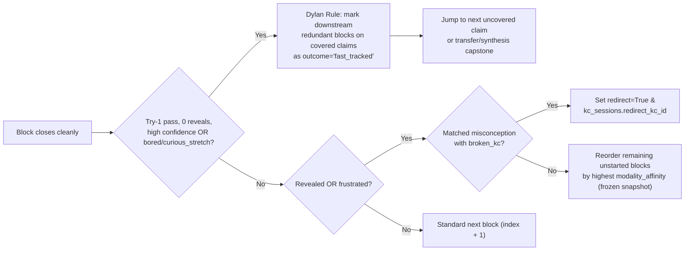
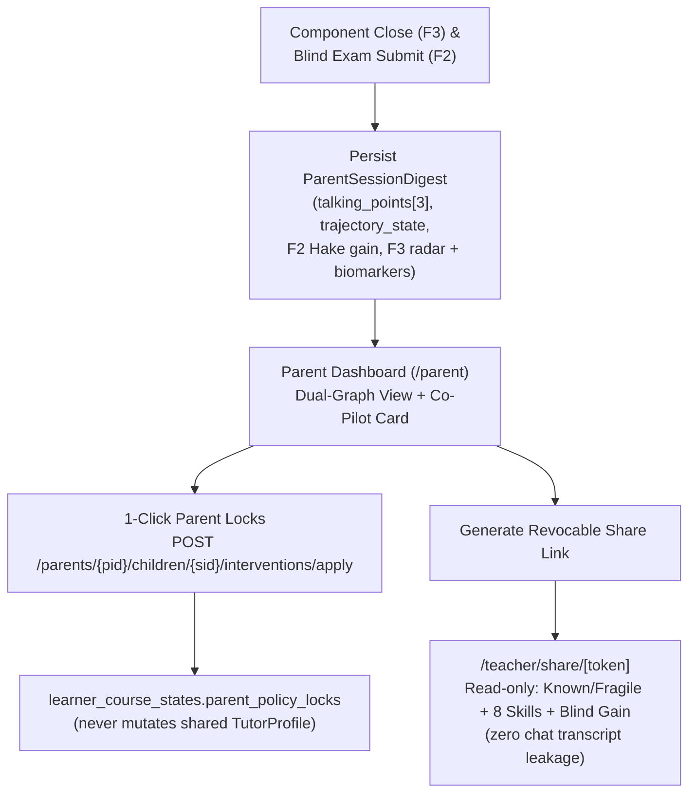

# Proposed Architecture Overview: F4 & F6 (Post-F2/F3 Baseline)

**Repository:** `mv97hub/aitutor-mvp`  
**Related Docs:** [F3 Architecture](./f3-architecture.md) · [F2 Architecture](./f2-architecture.md)

## Current Live Production Baseline

All four slices below are merged on `main` and verified live on Render:
- **F3 — Eight Skills, Biomarkers & Shared Radar** (`047_graph2_skills_and_state`, PR #231): `StudentEducationalState`, `LearnerCourseState`, `SkillObservation`, 4 biomarkers, frozen 3-line tutor note, shared radar.
- **F2 — Quarantined Blind Pre/Post Evaluator** (`048_blind_evaluator_tables`, PR #234): AST-quarantined `blind_evaluator.py`, 40/30/30 cached Pre/Post forms (`BlindExam`, `BlindExamAttempt`), exact Hake normalized gain, quiet `/exam` UI, and `epistemic_sandbox` harness bridge.
- **Harness Audit & Block-Scoring Fixes** (PR #233, PR #235, PR #236): zero-leak/zero-giveaway checks, back-to-back first-try MCQ scoring fix, `bite_sized` 2-sentence cap, and Try-1 MCQ non-reveal guard.

### Live Multi-Course Benchmark & F2 Epistemic Sandbox Evidence (2026-11-27)

| Course | Run ID | Chats / Turns | Quality Checks (`err / giv / ff / 1q / ask0`) | F2 Epistemic Sandbox (`student_id=null`) |
|---|---|---|---|---|
| **Treaty of Versailles** *(1 component)* | `826d51c0` | 4/4 · 98 turns · \$0.0317 | `0` err · `0` giv · `0` ff · `27/27` (100%) · `34/35` (97.1%) | **76.9%–92.3%** (avg **86.5%**); Item 5 missed across 4/4 chats *(Germany singled out vs. equal punishment)* |
| **How does AI Work** *(5 components)* | `d5d2cf35` | 8/10\* · 148 turns · \$0.0387 | `0` err · `0` giv · `0` ff · `0` too_long · `12/12` (100%) · `44/45` (97.8%) | **53.8%–69.2%** (avg **64.1%**) on single-component chats; `AI_Child13` passed 4/4 finished components as `known` |

**Two benchmark takeaways:**
1. **Multi-component F2 enhancement:** On a 5-component course, a single component chat only covers ~1/5 of the course-level blind Post-Test (`64.1%` avg vs. `86.5%` on the 1-component course). Adding a course-level epistemic endpoint (`POST /kc/harness/runs/{run_id}/blind-post-test`) that stitches a persona's tutor utterances across *all* components of a course will make multi-component F2 evaluations apples-to-apples.
2. **Runner note (`*`):** Chats 9 and 10 of `d5d2cf35` stalled at `0` turns after 8/10 completed (cleanly cancelled) — worth checking the in-process Next.js harness runner timeout/concurrency behavior at `concurrency: 4`.

---

This brief reconciles PR #194's `F4` and `F6` designs against the **actual live schema (`047` + `048`)** and standing F3 rules (one scale, no second ICAP number, frozen mid-component tutor note, harness isolation), so we can sign off on **one** of these two slices next.

---

## Option 1 — Feature 4 (`F4`): Dynamic Block Policy Router

**Goal:** Replace linear `next_idx = index + 1` traversal inside a component with a deterministic `select_next_block()` router that (a) fast-tracks high-mastery learners past redundant checks (*Dylan Rule*) and (b) pivots or redirects struggling learners using already-recorded modality affinity and broken-prerequisite misconceptions.

**Schema Impact:** **Zero Alembic migrations required.** `kc_sessions.redirect_kc_id` (`apps/api/app/models.py`), `KcNode.mastery_spec`, and `StudentEducationalState.modality_affinity` already exist in production.

### Key Architectural Alignment (Resolving PR #194 vs. Standing F3 Rules)
> [!IMPORTANT]
> PR #194's earlier `F4` draft referenced an `icap_tier >= 3` field. Under the standing F3 rule (**one scale, no second ICAP number**), `F4` should **not** add an ICAP column or numeric tier. Instead, fast-tracking derives deterministically from **block type** + **`mastery_spec.claims`**.

### Design Summary

1. **Affect vocabulary (`apps/api/app/kc_prompt.py`):** Add `"bored"` and `"curious_stretch"` to `AFFECTS` (prompt-only enum extension; zero breaking schema change).
2. **Deterministic `select_next_block()` (`apps/api/app/kc_loop.py`):** Called identically by **both** `resolve_block_turn()` and `forecast_this_turn()` so prompt forecast and runtime loop never diverge:
   - **Dylan Rule (Fast-Track Compression):** Triggers only on an unassisted Try-1 pass (`reveals == 0`, `attempts == 1`) of a higher-demand block (`case_study`, `socratic`, `worked_example`, `teach_back`, `spot_the_flaw`, `passage_ela`) when `confidence == "high"` or `affect in ("bored", "curious_stretch")`. Marks downstream lower-demand blocks (`mcq`, `retrieval_check`, `topic_goal`) whose `claim_ids` are already covered by passed blocks as `outcome = "fast_tracked"` and jumps straight to the next uncovered claim or capstone block.
   - **No-op on legacy courses:** If `mastery_spec` is empty (`{}`), `select_next_block()` falls back cleanly to `index + 1` (preserving F3's legacy-course safety invariant).
   - **Struggle Pivot & Prerequisite Redirect:** On `outcome == "revealed"` or `affect == "frustrated"`, if a matched misconception names a `broken_kc`, set `redirect=True` and persist `kc_sessions.redirect_kc_id`. Otherwise, prefer the next remaining unstarted block matching the child's highest-affinity modality from the **frozen session snapshot** (never re-reading live learner state mid-component, preserving F3's frozen-session rule).
3. **Closure credit (`apps/api/app/kc.py` & `apps/api/app/block_score.py`):** Update `_last_block_finished()`, `_walk_fragile()`, and F3's eligible-substep filter so `"fast_tracked"` counts as non-fragile completion credit without fabricating fake skill observations (F3 only grades skills with real child evidence).
4. **Verification:** Unit tests on `select_next_block()` + forecast/resolve parity + harness validation with `AI_Child3` (fast-moving) and `AI_Child10` (struggling).

---

## Option 2 — Feature 6 (`F6`): Active Parent Co-Pilot & Revocable Teacher Snapshot

**Goal:** Turn the read-only `/parent` progress page into an actionable Co-Pilot powered directly by **live F2 (Hake gain) + live F3 (8-skill radar, biomarkers, misconceptions)**, plus a revocable read-only share link for teachers (`/teacher/share/[token]`).

**Schema Impact:** One additive Alembic migration **`049_parent_copilot_and_teacher_share.py`** (revising `048_blind_evaluator_tables`):
- Add nullable/defaulted metadata on `kc_goals`: `catalog_tier` (`core | enrichment | custom`), `upvotes_count` (`0`), `default_archetype` (`nullable`).
- Add `parent_policy_locks` (`JSON`, default `{}`) on existing `learner_course_states` (reusing F3's per-`(student_id, goal_id)` row instead of creating a duplicate course-policy table).
- Create `parent_session_digests`: deterministic/summarized digest written at component close (`summary`, `talking_points[3]`, `biomarkers_snapshot`, `trajectory_state`, `recommended_interventions`).
- Create `teacher_share_tokens`: `token_hash` (SHA-256 only — raw token shown once on creation), `parent_id`, `student_id`, `goal_id` (optional scope), `expires_at`, `revoked_at`.

### Design Summary

1. **Zero mutation of shared `TutorProfile`:** Parent Co-Pilot nudges (*"More guided examples"*, *"Anchor in [Interest]"*, *"Gentler Socratic challenge"*) write exclusively into `learner_course_states.parent_policy_locks` and are copied onto the **next** component's frozen session snapshot (never rewriting a live lesson mid-component).
2. **Privacy & Harness Isolation:**
   - Harness children (`is_harness` / synthetic) never create `parent_session_digests` or `teacher_share_tokens`.
   - `/teacher/share/[token]` returns **read-only mastery, active misconceptions, 8-skill radar, and F2 Hake gain** — never raw chat transcripts, PII beyond first name/grade band, or edit controls. Revoking sets `revoked_at` and immediately returns `404`.
3. **Zero overlap with live tutor loop:** F6 touches parent/teacher routes and post-close digest persistence, making it the lowest-conflict slice if `kc_loop.py` or tutor prompts are being edited concurrently.

---

## Three Quick Decisions Needed Before Building

| Question | Recommendation |
|---|---|
| **1. Build order: F6 first or F4 first?** | **F6** if `kc_loop.py` / prompts are actively changing (zero merge conflicts); **F4** if `kc_loop.py` is quiet and we want immediate harness speed/adaptation gains. |
| **2. Confirm F4 no-ICAP rule:** Should the Dylan Rule key strictly off block type + `mastery_spec.claims` (no second ICAP scale)? | **Yes** — stays 100% consistent with F3's standing rule. |
| **3. Confirm F6 table reuse:** Store `parent_policy_locks` on F3's existing `learner_course_states` table instead of adding a parallel `student_course_policies` table? | **Yes** — avoids duplicate `(student_id, goal_id)` tables while keeping migration `049` minimal. |
